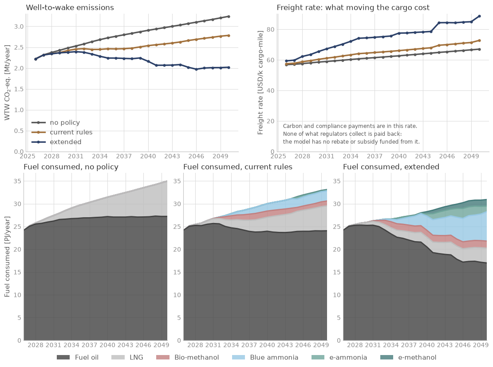

<!--
SPDX-FileCopyrightText: 2026 Fonden Mærsk Mc-Kinney Møller Center for Zero Carbon Shipping
SPDX-License-Identifier: CC-BY-4.0
-->

# Caribbean shipping under global and EU rules

[Regional networks](regional-networks.md) · decks `simulations/examples/example_5/`

[](https://colab.research.google.com/github/zerocarbonshipping/navigate-zcs/blob/workshop-colab/docs/examples/caribbean-explore.ipynb)

How are a region's own ships affected by global and EU rules, today and if
extended to them?

## The case


- **Ships:** 330 regional ships (144 tugs, 47 ferries, 85 general cargo ships
  and 54 small tankers), nearly all under 5,000 GT, and 40 container feeders of
  about 1,500 TEU. Fleet counts from the IMO CARES report (2024); the split of
  the cargo ships is INVENTED.
- **Routes:** the feeders on a Miami - Kingston - Trinidad - Martinique loop;
  the regional ships inside and between the three Caribbean ports.
- **Fuels:** blue and e-ammonia, e-methanol and bio-methanol, made in Trinidad,
  on the US Gulf Coast or in Chile and shipped in; LNG at Kingston and Miami only.
- **Policy:** three decks, which differ in their policy lines only: no policy;
  today's rules (a global fuel standard, the EU ETS and FuelEU) on the feeders
  only; the same rules extended to the regional ships.
- **Horizon:** 2026 to 2050, yearly.

The regional fleet is not calibrated: with the library's world-average ships it
burns more fuel than CARES reports, so compare the decks with each other, not
with the region's real totals.

## Results



All ships together: today's rules, which reach the feeders only, cut emissions in
2050 from 3.2 to 2.8 Mt CO2e a year; extended to the regional ships, they cut
them to 2.0 Mt, with 35 % of the energy from alternative fuels. Summed over 2026
to 2050: 70, 63 and 55 Mt.

## The deck

:::::{tab-set}

::::{tab-item} The three decks
```{literalinclude} ../../simulations/examples/example_5/example_5_no_policy.nav
:language: python
:caption: example_5_no_policy.nav
```
```{literalinclude} ../../simulations/examples/example_5/example_5_current_rules.nav
:language: python
:caption: example_5_current_rules.nav
```
```{literalinclude} ../../simulations/examples/example_5/example_5_extended.nav
:language: python
:caption: example_5_extended.nav
```
::::

::::{tab-item} Fleet
```{literalinclude} ../../simulations/examples/example_5/includes/fleet.inc
:language: python
:caption: includes/fleet.inc
```
```{literalinclude} ../../simulations/examples/example_5/includes/converter_available.inc
:language: python
:caption: includes/converter_available.inc
```
::::

::::{tab-item} Route
```{literalinclude} ../../simulations/examples/example_5/includes/route.inc
:language: python
:caption: includes/route.inc
```
```{literalinclude} ../../simulations/examples/example_5/includes/ports.inc
:language: python
:caption: includes/ports.inc
```
```{literalinclude} ../../simulations/examples/example_5/includes/bunker_logistics.inc
:language: python
:caption: includes/bunker_logistics.inc
```
::::

::::{tab-item} Fuel
```{literalinclude} ../../simulations/examples/example_5/includes/fuel_production.inc
:language: python
:caption: includes/fuel_production.inc
```
```{literalinclude} ../../simulations/examples/example_5/includes/regions.inc
:language: python
:caption: includes/regions.inc
```
```{literalinclude} ../../simulations/examples/example_5/includes/producer.inc
:language: python
:caption: includes/producer.inc
```
::::

::::{tab-item} Policy
```{literalinclude} ../../simulations/examples/example_5/includes/policy_gfs.inc
:language: python
:caption: includes/policy_gfs.inc
```
```{literalinclude} ../../simulations/examples/example_5/includes/policy_eu.inc
:language: python
:caption: includes/policy_eu.inc
```
```{literalinclude} ../../simulations/examples/example_5/includes/extend_to_regional.inc
:language: python
:caption: includes/extend_to_regional.inc
```
::::

::::{tab-item} Report
```{literalinclude} ../../simulations/examples/example_5/includes/report.inc
:language: python
:caption: includes/report.inc
```
::::

:::::

## Build it with an AI assistant

This deck was built from the prompt below by an assistant that saw only the
prompt. A new regional network starts from it, or from the case whose routes
look most like yours. [Session 5](../workshop/05-build-your-own-case.ipynb)
shows how to use it.

::::{dropdown} Full prompt for this case
```{include} ../workshop/prompt-bank.md
:start-after: <!-- bank:caribbean -->
:end-before: <!-- /bank:caribbean -->
```
::::

## Run it yourself

In Colab: the [explore notebook](caribbean-explore.ipynb) runs the three decks
and lets you move one lever on the extended one. On your machine, from the
repository root:

```bash
python -m navigate simulations/examples/example_5/example_5_current_rules.nav -d ./assumptions
```

To install Navigate, follow the [installation steps in the README](https://github.com/zerocarbonshipping/navigate-zcs/blob/dev-workshop/README.md#installation),
or the more detailed [Getting started](../tutorials/getting_started.md) tutorial.
