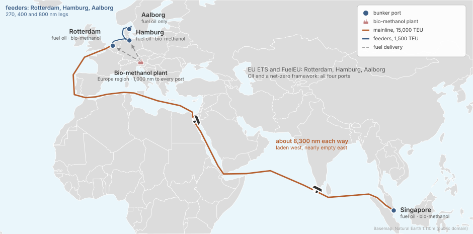
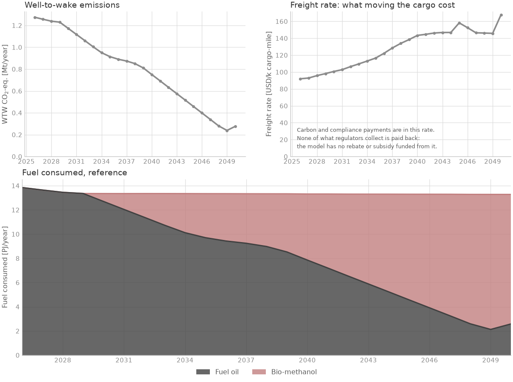

<!--
SPDX-FileCopyrightText: 2026 Fonden Mærsk Mc-Kinney Møller Center for Zero Carbon Shipping
SPDX-License-Identifier: CC-BY-4.0
-->

# A mainline and its feeders

[Regional networks](regional-networks.md) · deck `simulations/examples/example_1/`

[](https://colab.research.google.com/github/zerocarbonshipping/navigate-zcs/blob/workshop-colab/docs/examples/mainline-and-feeders-explore.ipynb)

How do two ship sizes on connected routes choose fuels when the ports supply them
unevenly?

## The case



- **Ships:** two fleets on two routes. 5 mainline container ships
  (~15,000 TEU), four in five on fuel oil, the rest on methanol; 50 feeders
  (~1,500 TEU), almost all on fuel oil. Both can order or convert to methanol
  ships.
- **Routes:** the mainline sails Singapore to Rotterdam, 8,300 nm each way in the
  deck, laden west and nearly empty east; the feeders sail Rotterdam, Hamburg
  and Aalborg.
- **Fuels:** fuel oil at every port; bio-methanol from a European plant, at
  every port but Aalborg.
- **Policy:** EU ETS and FuelEU on the three European ports; CII and a net-zero
  framework on all four, the framework with values that are the deck's own, not
  the data library's.
- **Horizon:** 2026 to 2050, yearly.

## Results



Emissions fall from 1.3 to 0.3 Mt CO2e a year, and alternative fuels make up
80 % of the energy burnt in 2050. Container ships carry TEU, so the freight rate
here is per thousand TEU-miles: do not compare it with the bulk carriers'.

## The deck

:::::{tab-set}

::::{tab-item} example_1.nav
```{literalinclude} ../../simulations/examples/example_1/example_1.nav
:language: python
```
::::

::::{tab-item} Fleets
```{literalinclude} ../../simulations/examples/example_1/includes/mainlines.inc
:language: python
:caption: includes/mainlines.inc
```
```{literalinclude} ../../simulations/examples/example_1/includes/feeders.inc
:language: python
:caption: includes/feeders.inc
```
```{literalinclude} ../../simulations/examples/example_1/includes/mainlines_curves.inc
:language: python
:caption: includes/mainlines_curves.inc
```
```{literalinclude} ../../simulations/examples/example_1/includes/feeders_curves.inc
:language: python
:caption: includes/feeders_curves.inc
```
::::

::::{tab-item} Routes
```{literalinclude} ../../simulations/examples/example_1/includes/route.inc
:language: python
:caption: includes/route.inc
```
```{literalinclude} ../../simulations/examples/example_1/includes/ports.inc
:language: python
:caption: includes/ports.inc
```
```{literalinclude} ../../simulations/examples/example_1/includes/bunker_logistics.inc
:language: python
:caption: includes/bunker_logistics.inc
```
::::

::::{tab-item} Fuel
```{literalinclude} ../../simulations/examples/example_1/includes/fuel_production.inc
:language: python
:caption: includes/fuel_production.inc
```
```{literalinclude} ../../simulations/examples/example_1/includes/regions.inc
:language: python
:caption: includes/regions.inc
```
```{literalinclude} ../../simulations/examples/example_1/includes/producer.inc
:language: python
:caption: includes/producer.inc
```
::::

::::{tab-item} Regulation
```{literalinclude} ../../simulations/examples/example_1/includes/cii.inc
:language: python
:caption: includes/cii.inc
```
```{literalinclude} ../../simulations/examples/example_1/includes/eu_ets.inc
:language: python
:caption: includes/eu_ets.inc
```
```{literalinclude} ../../simulations/examples/example_1/includes/fuel_eu.inc
:language: python
:caption: includes/fuel_eu.inc
```
```{literalinclude} ../../simulations/examples/example_1/includes/net_zero_framework.inc
:language: python
:caption: includes/net_zero_framework.inc
```
::::

::::{tab-item} Decisions and report
```{literalinclude} ../../simulations/examples/example_1/includes/decision_processes.inc
:language: python
:caption: includes/decision_processes.inc
```
```{literalinclude} ../../simulations/examples/example_1/includes/report.inc
:language: python
:caption: includes/report.inc
```
::::

:::::

## Build it with an AI assistant

The prompt below rebuilds this deck exactly: an assistant that saw only the
prompt reproduced its results to the tonne. The deck's own numbers are in it as
the person's numbers, marked GIVEN, so they are not a source. A network of
connected routes starts from it. [Session 5](../workshop/05-build-your-own-case.ipynb)
shows how to use it.

::::{dropdown} Full prompt for this case
```{include} ../workshop/prompt-bank.md
:start-after: <!-- bank:mainline-feeders -->
:end-before: <!-- /bank:mainline-feeders -->
```
::::

## Run it yourself

In Colab: the [explore notebook](mainline-and-feeders-explore.ipynb) runs the deck
and lets you move one lever. On your machine, from the repository root:

```bash
python -m navigate simulations/examples/example_1/example_1.nav -d ./assumptions
```

To install Navigate, follow the [installation steps in the README](https://github.com/zerocarbonshipping/navigate-zcs/blob/dev-workshop/README.md#installation),
or the more detailed [Getting started](../tutorials/getting_started.md) tutorial.
