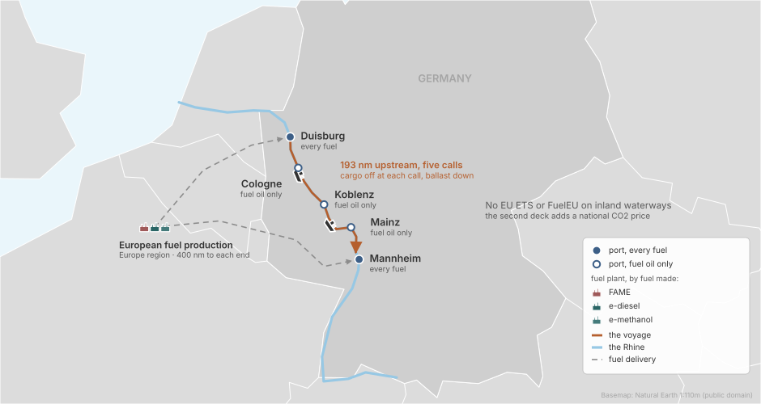
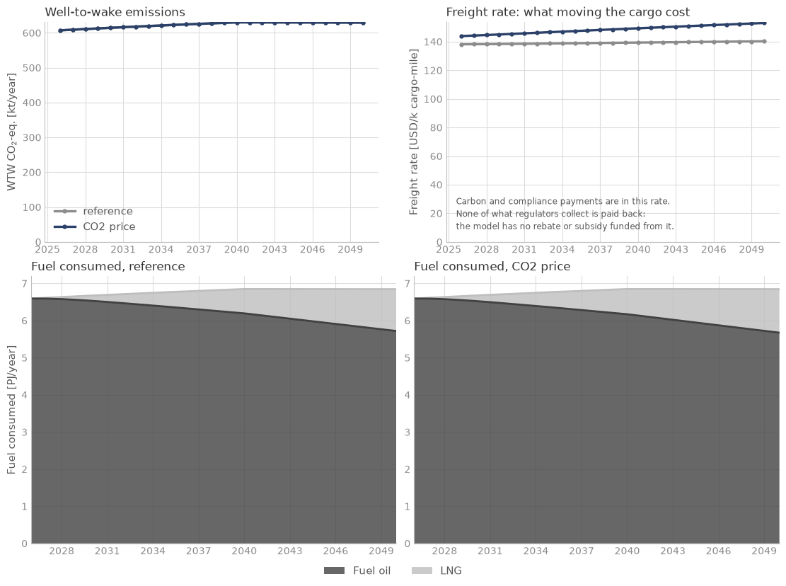

<!--
SPDX-FileCopyrightText: 2026 Fonden Mærsk Mc-Kinney Møller Center for Zero Carbon Shipping
SPDX-License-Identifier: CC-BY-4.0
-->

# Inland waterways in Germany

[Specific trades](specific-trades.md) · decks `simulations/examples/example_6/`

[](https://colab.research.google.com/github/zerocarbonshipping/navigate-zcs/blob/workshop-colab/docs/examples/rhine-explore.ipynb)

Does a national CO2 price move owners to drop-in fuels or new engines?

## The case



- **Ships:** 300 large Rhine motor cargo vessels, all on fuel oil in 2026. The
  library has no inland vessel, so the ship is a library general cargo ship
  resized for the Rhine (INVENTED). The owners can burn a drop-in fuel (FAME,
  e-diesel) in the ships they have, or order LNG or methanol ships.
- **Route:** one route up the Rhine, Duisburg, Cologne, Koblenz, Mainz and
  Mannheim, a quarter of the cargo discharged at each call, then back to
  Duisburg in ballast.
- **Fuels:** fuel oil at every port; LNG, FAME, e-diesel and e-methanol at
  Duisburg and Mannheim only, made in Europe.
- **Policy:** two decks: no policy, and Germany's national CO2 price, 65 USD/t in
  2026 to 150 in 2050 (INVENTED), as a copy of the library's EU ETS on the five
  ports. EU ETS and FuelEU do not cover inland waterways.
- **Horizon:** 2026 to 2050, yearly.

## Results



The CO2 price raises the freight rate in 2050 from 140 to 153 USD per thousand
cargo-miles and leaves emissions where they were, 607 kt CO2e in 2026 and 629 kt
in 2050: no drop-in fuel is bunkered in either deck, and the owners pay the price.

## The deck

:::::{tab-set}

::::{tab-item} The two decks
```{literalinclude} ../../simulations/examples/example_6/example_6_reference.nav
:language: python
:caption: example_6_reference.nav
```
```{literalinclude} ../../simulations/examples/example_6/example_6_co2_price.nav
:language: python
:caption: example_6_co2_price.nav
```
::::

::::{tab-item} Placeholders
```{literalinclude} ../../simulations/examples/example_6/includes/placeholders.inc
:language: python
:caption: includes/placeholders.inc
```
::::

::::{tab-item} Fleet
```{literalinclude} ../../simulations/examples/example_6/includes/fleet.inc
:language: python
:caption: includes/fleet.inc
```
::::

::::{tab-item} Route
```{literalinclude} ../../simulations/examples/example_6/includes/route.inc
:language: python
:caption: includes/route.inc
```
```{literalinclude} ../../simulations/examples/example_6/includes/ports.inc
:language: python
:caption: includes/ports.inc
```
```{literalinclude} ../../simulations/examples/example_6/includes/bunker_logistics.inc
:language: python
:caption: includes/bunker_logistics.inc
```
::::

::::{tab-item} Fuel
```{literalinclude} ../../simulations/examples/example_6/includes/fuel_production.inc
:language: python
:caption: includes/fuel_production.inc
```
```{literalinclude} ../../simulations/examples/example_6/includes/regions.inc
:language: python
:caption: includes/regions.inc
```
```{literalinclude} ../../simulations/examples/example_6/includes/producer.inc
:language: python
:caption: includes/producer.inc
```
::::

::::{tab-item} CO2 price
```{literalinclude} ../../simulations/examples/example_6/includes/co2_price.inc
:language: python
:caption: includes/co2_price.inc
```
::::

::::{tab-item} Report
```{literalinclude} ../../simulations/examples/example_6/includes/report.inc
:language: python
:caption: includes/report.inc
```
::::

:::::

## Build it with an AI assistant

These decks were built from the prompt below by an assistant that saw only the
prompt. A trade under a national policy starts from it.
[Session 5](../workshop/05-build-your-own-case.ipynb) shows how to use it.

::::{dropdown} Full prompt for this case
```{include} ../workshop/prompt-bank.md
:start-after: <!-- bank:rhine -->
:end-before: <!-- /bank:rhine -->
```
::::

### Variant

::::{dropdown} Coastal shipping in Norway: two ship classes under a national CO2 tax
```{include} ../workshop/prompt-bank.md
:start-after: <!-- bank:norway -->
:end-before: <!-- /bank:norway -->
```
::::

## Run it yourself

In Colab: the [explore notebook](rhine-explore.ipynb) runs both decks and lets
you move one lever on the deck with the CO2 price. On your machine, from the
repository root:

```bash
python -m navigate simulations/examples/example_6/example_6_co2_price.nav -d ./assumptions
```

To install Navigate, follow the [installation steps in the README](https://github.com/zerocarbonshipping/navigate-zcs/blob/dev-workshop/README.md#installation),
or the more detailed [Getting started](../tutorials/getting_started.md) tutorial.
