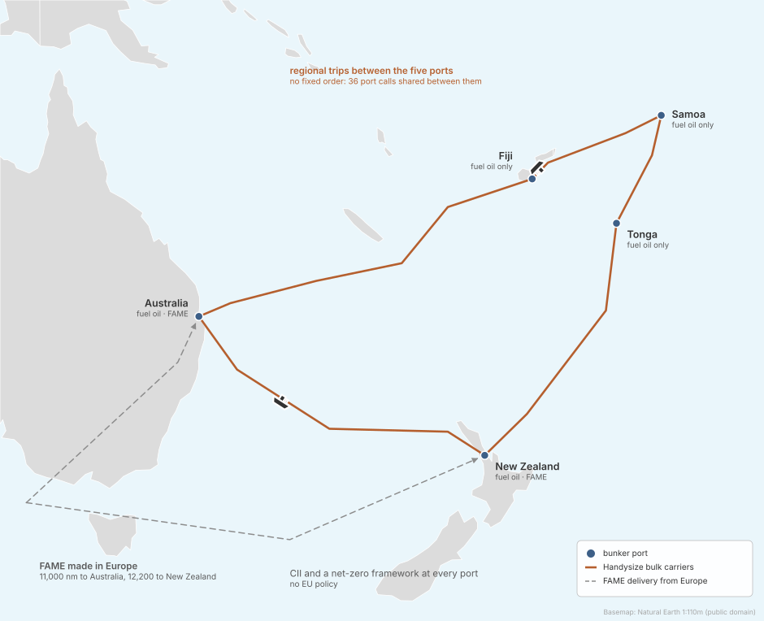
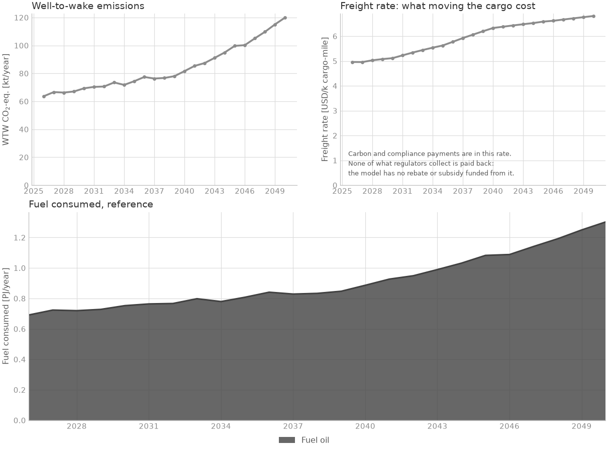

<!--
SPDX-FileCopyrightText: 2026 Fonden Mærsk Mc-Kinney Møller Center for Zero Carbon Shipping
SPDX-License-Identifier: CC-BY-4.0
-->

# Island trade in the South Pacific

[Regional networks](regional-networks.md) · deck `simulations/examples/example_2/`

[](https://colab.research.google.com/github/zerocarbonshipping/navigate-zcs/blob/workshop-colab/docs/examples/south-pacific-explore.ipynb)

Can a regional bulk trade switch to biodiesel when only its main ports supply it?

## The case



- **Ships:** 6 Handysize bulk carriers (~26,000 DWT), all on fuel oil, the same
  design throughout: the oil engine can burn biodiesel (FAME) instead. The
  owners can fit seven efficiency measures.
- **Route:** regional trips between Australia, New Zealand, Fiji, Samoa and Tonga,
  with no fixed order of calls. Trade grows 5 % a year.
- **Fuels:** fuel oil at every port; FAME made from used cooking oil in Europe,
  shipped 11,000 to 12,200 nm, and bunkered in Australia and New Zealand only.
- **Policy:** CII and a net-zero framework on every port, the framework with
  values that are the deck's own, not the data library's. No EU policy.
- **Horizon:** 2026 to 2050, yearly.

## Results



No FAME is bunkered at any point: fuel oil stays cheaper under these rules, and
emissions grow with trade, from 64 to 120 kt CO2e a year.

## The deck

:::::{tab-set}

::::{tab-item} example_2.nav
```{literalinclude} ../../simulations/examples/example_2/example_2.nav
:language: python
```
::::

::::{tab-item} Fleet
```{literalinclude} ../../simulations/examples/example_2/includes/fleet.inc
:language: python
:caption: includes/fleet.inc
```
```{literalinclude} ../../simulations/examples/example_2/includes/energy_efficiencies.inc
:language: python
:caption: includes/energy_efficiencies.inc
```
```{literalinclude} ../../simulations/examples/example_2/includes/fleet_curves.inc
:language: python
:caption: includes/fleet_curves.inc
```
```{literalinclude} ../../simulations/examples/example_2/includes/energy_efficiencies_curves.inc
:language: python
:caption: includes/energy_efficiencies_curves.inc
```
::::

::::{tab-item} Route
```{literalinclude} ../../simulations/examples/example_2/includes/route.inc
:language: python
:caption: includes/route.inc
```
```{literalinclude} ../../simulations/examples/example_2/includes/ports.inc
:language: python
:caption: includes/ports.inc
```
```{literalinclude} ../../simulations/examples/example_2/includes/bunker_logistics.inc
:language: python
:caption: includes/bunker_logistics.inc
```
::::

::::{tab-item} Fuel
```{literalinclude} ../../simulations/examples/example_2/includes/fuel_production.inc
:language: python
:caption: includes/fuel_production.inc
```
```{literalinclude} ../../simulations/examples/example_2/includes/regions.inc
:language: python
:caption: includes/regions.inc
```
```{literalinclude} ../../simulations/examples/example_2/includes/producer.inc
:language: python
:caption: includes/producer.inc
```
::::

::::{tab-item} Regulation
```{literalinclude} ../../simulations/examples/example_2/includes/cii.inc
:language: python
:caption: includes/cii.inc
```
```{literalinclude} ../../simulations/examples/example_2/includes/net_zero_framework.inc
:language: python
:caption: includes/net_zero_framework.inc
```
::::

::::{tab-item} Decisions
```{literalinclude} ../../simulations/examples/example_2/includes/decision_processes.inc
:language: python
:caption: includes/decision_processes.inc
```
::::

:::::

## Build it with an AI assistant

The prompt below rebuilds this deck exactly: an assistant that saw only the
prompt reproduced its results. The deck's own numbers are in it as the person's
numbers, marked GIVEN, so they are not a source. Ships on trips between several
ports in no fixed order, some ports without the new fuel, start from it.
[Session 5](../workshop/05-build-your-own-case.ipynb) shows how to use it.

::::{dropdown} Full prompt for this case
```{include} ../workshop/prompt-bank.md
:start-after: <!-- bank:south-pacific -->
:end-before: <!-- /bank:south-pacific -->
```
::::

## Run it yourself

In Colab: the [explore notebook](south-pacific-explore.ipynb) runs the deck and
lets you move one lever. On your machine, from the repository root:

```bash
python -m navigate simulations/examples/example_2/example_2.nav -d ./assumptions
```

To install Navigate, follow the [installation steps in the README](https://github.com/zerocarbonshipping/navigate-zcs/blob/dev-workshop/README.md#installation),
or the more detailed [Getting started](../tutorials/getting_started.md) tutorial.
