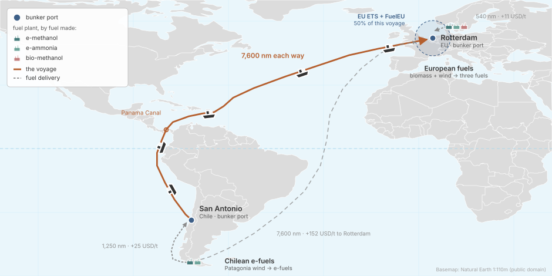
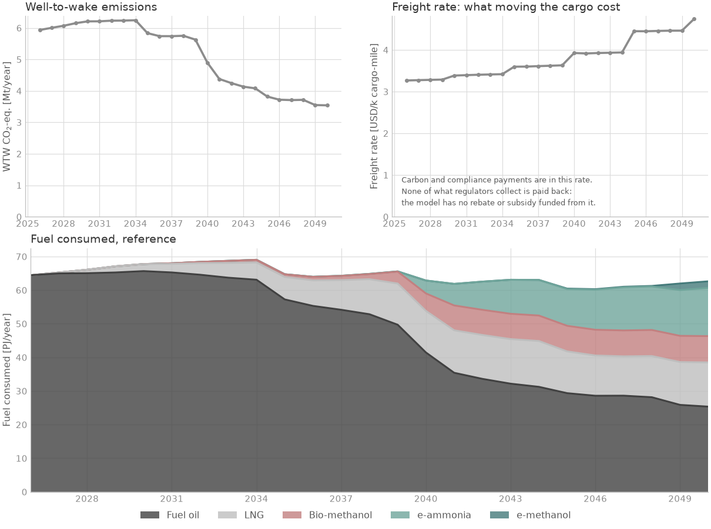

<!--
SPDX-FileCopyrightText: 2026 Fonden Mærsk Mc-Kinney Møller Center for Zero Carbon Shipping
SPDX-License-Identifier: CC-BY-4.0
-->

# A trade route, Chile to Rotterdam

[Specific trades](specific-trades.md) · deck `simulations/examples/example_4/` · the case of
[Session 1](../workshop/01-run-a-simple-case.ipynb)

[](https://colab.research.google.com/github/zerocarbonshipping/navigate-zcs/blob/workshop-colab/docs/workshop/01-run-a-simple-case.ipynb)

Which fuels do owners choose on one long trade under EU policy?

## The case



- **Ships:** 300 Panamax bulk carriers (about 80,000 DWT), owned by many
  companies, all on fuel oil in 2026. The owners can order LNG, methanol or
  ammonia ships, convert, and fit efficiency measures.
- **Route:** San Antonio to Rotterdam via the Panama Canal, about 7,600 nm each
  way, laden out and in ballast home.
- **Fuels:** fuel oil and LNG from the world market; e-methanol and e-ammonia
  made in Chile or in Europe, bio-methanol in Europe.
- **Policy:** EU ETS and FuelEU Maritime, each covering half of the voyage.
- **Horizon:** 2026 to 2050, yearly.

## Results



Emissions fall from 5.9 to 3.5 Mt CO2e a year, and alternative fuels make up
38.5 % of the energy burnt in 2050. [Session 1](../workshop/01-run-a-simple-case.ipynb)
varies the prices and the policy, [Session 3](../workshop/03-how-a-navigate-model-is-built.ipynb)
shows how the deck is built and [Session 4](../workshop/04-how-navigate-solves.ipynb)
how the model solves it.

## The deck

:::::{tab-set}

::::{tab-item} example_4.nav
```{literalinclude} ../../simulations/examples/example_4/example_4.nav
:language: python
```
::::

::::{tab-item} Fleet
```{literalinclude} ../../simulations/examples/example_4/includes/fleet.inc
:language: python
:caption: includes/fleet.inc
```
```{literalinclude} ../../simulations/examples/example_4/includes/energy_efficiencies.inc
:language: python
:caption: includes/energy_efficiencies.inc
```
::::

::::{tab-item} Route
```{literalinclude} ../../simulations/examples/example_4/includes/route.inc
:language: python
:caption: includes/route.inc
```
```{literalinclude} ../../simulations/examples/example_4/includes/ports.inc
:language: python
:caption: includes/ports.inc
```
```{literalinclude} ../../simulations/examples/example_4/includes/bunker_logistics.inc
:language: python
:caption: includes/bunker_logistics.inc
```
::::

::::{tab-item} Fuel
```{literalinclude} ../../simulations/examples/example_4/includes/fuel_production.inc
:language: python
:caption: includes/fuel_production.inc
```
```{literalinclude} ../../simulations/examples/example_4/includes/regions.inc
:language: python
:caption: includes/regions.inc
```
```{literalinclude} ../../simulations/examples/example_4/includes/producer.inc
:language: python
:caption: includes/producer.inc
```
::::

::::{tab-item} Regulation
```{literalinclude} ../../simulations/examples/example_4/includes/eu_ets.inc
:language: python
:caption: includes/eu_ets.inc
```
```{literalinclude} ../../simulations/examples/example_4/includes/fuel_eu.inc
:language: python
:caption: includes/fuel_eu.inc
```
::::

::::{tab-item} Report
```{literalinclude} ../../simulations/examples/example_4/includes/report.inc
:language: python
:caption: includes/report.inc
```
::::

:::::

## Build it with an AI assistant

This is the model of the specific-trade family: a new trade between named
ports starts from its full prompt. The variants below change only what their list
says. [Session 5](../workshop/05-build-your-own-case.ipynb) shows how to use them.

::::{dropdown} Full prompt for this trade route
```{include} ../workshop/prompt-bank.md
:start-after: <!-- bank:copper -->
:end-before: <!-- /bank:copper -->
```
::::

### Variants

::::{dropdown} One trade, two ports: Suezmax tankers from Saudi Arabia to China, with no policy
```{include} ../workshop/prompt-bank.md
:start-after: <!-- bank:gulf-china -->
:end-before: <!-- /bank:gulf-china -->
```
::::

::::{dropdown} LNG carriers from Qatar to Japan: which fuel wins on cost alone
```{include} ../workshop/prompt-bank.md
:start-after: <!-- bank:qatar-lng -->
:end-before: <!-- /bank:qatar-lng -->
```
::::

::::{dropdown} EU short-sea feeders: what EU ETS and FuelEU make the owners do
```{include} ../workshop/prompt-bank.md
:start-after: <!-- bank:eu-feeders -->
:end-before: <!-- /bank:eu-feeders -->
```
::::

::::{dropdown} Green finance: do cheaper loans bring zero-emission ships forward?
```{include} ../workshop/prompt-bank.md
:start-after: <!-- bank:green-finance -->
:end-before: <!-- /bank:green-finance -->
```
::::

::::{dropdown} Two fleets, one market: what the owners' efficiency choices are worth
```{include} ../workshop/prompt-bank.md
:start-after: <!-- bank:two-fleets -->
:end-before: <!-- /bank:two-fleets -->
```
::::

[Two fleets in the Baltic](two-fleets.md) asks the same question on a regional
network, with a deck of its own.

## Run it yourself

In Colab: [Session 1](https://colab.research.google.com/github/zerocarbonshipping/navigate-zcs/blob/workshop-colab/docs/workshop/01-run-a-simple-case.ipynb).
On your machine, from the repository root:

```bash
python -m navigate simulations/examples/example_4/example_4.nav -d ./assumptions
```

To install Navigate, follow the [installation steps in the README](https://github.com/zerocarbonshipping/navigate-zcs/blob/dev-workshop/README.md#installation),
or the more detailed [Getting started](../tutorials/getting_started.md) tutorial.
