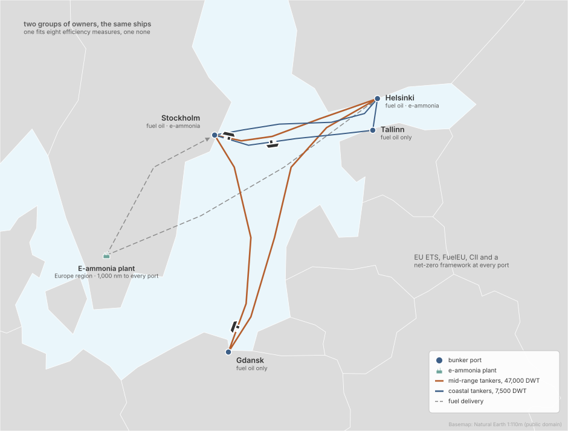
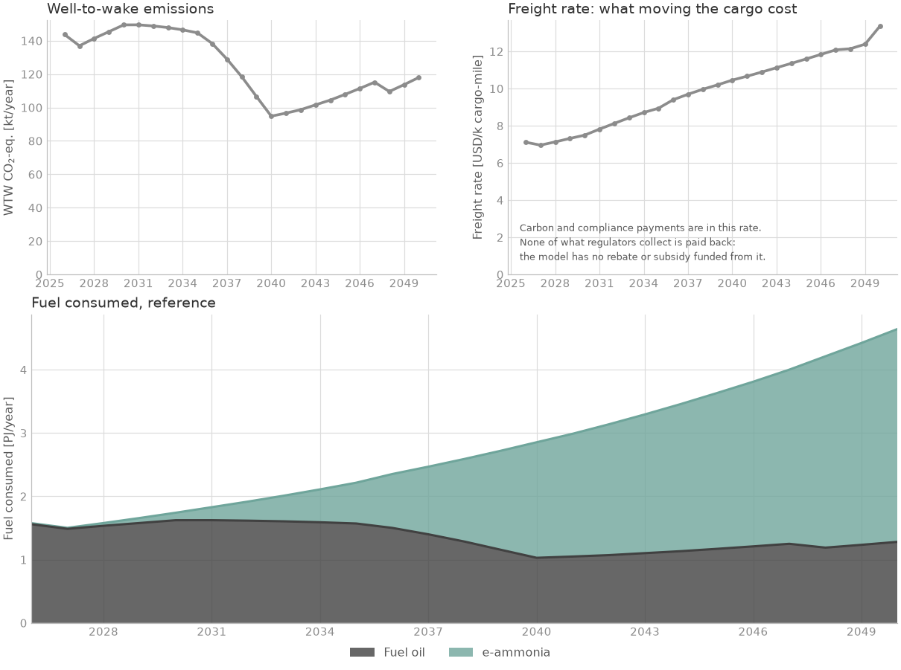
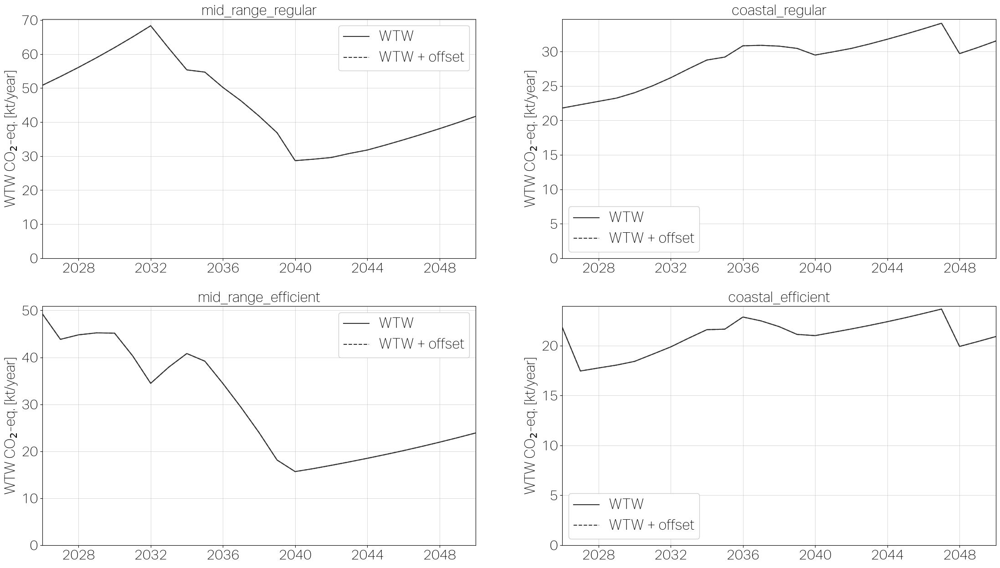

<!--
SPDX-FileCopyrightText: 2026 Fonden Mærsk Mc-Kinney Møller Center for Zero Carbon Shipping
SPDX-License-Identifier: CC-BY-4.0
-->

# Two fleets in the Baltic

[Regional networks](regional-networks.md) · deck `simulations/examples/example_3/`

[](https://colab.research.google.com/github/zerocarbonshipping/navigate-zcs/blob/workshop-colab/docs/examples/two-fleets-explore.ipynb)

How much do the owners' efficiency choices matter on the same trade?

## The case



- **Ships:** product tankers in the Baltic, in two fleets that are the same in
  everything but one choice. The *regular* owners fit no efficiency measure; the
  *efficient* owners can fit eight (air lubrication, rotor sails, hull paint,
  propeller devices and others). Each fleet starts with 2 MR tankers
  (~47,000 DWT) and 3 coastal tankers (~7,500 DWT): a handful of ships, not a
  market segment.
- **Routes:** the MR tankers sail Helsinki, Stockholm and Gdansk; the coastal
  tankers Helsinki, Tallinn and Stockholm. Trade grows 5 % a year.
- **Fuels:** fuel oil everywhere; e-ammonia from a European plant, bunkered at
  Helsinki and Stockholm only.
- **Policy:** EU ETS and FuelEU on every port, CII, and a net-zero framework
  whose values are the deck's own, not the data library's.
- **Horizon:** 2026 to 2050, yearly.

## Results



Both fleets together: e-ammonia is 72 % of the energy burnt in 2050.



Fleet by fleet: in 2050 the efficient MR tankers emit 24 kt CO2e against 42 kt
for the regular ones, and the efficient coastal tankers 21 kt against 32 kt.
Each panel has its own scale.

## The deck

:::::{tab-set}

::::{tab-item} example_3.nav
```{literalinclude} ../../simulations/examples/example_3/example_3.nav
:language: python
```
::::

::::{tab-item} Fleets
```{literalinclude} ../../simulations/examples/example_3/includes/regular_fleet.inc
:language: python
:caption: includes/regular_fleet.inc
```
```{literalinclude} ../../simulations/examples/example_3/includes/efficient_fleet.inc
:language: python
:caption: includes/efficient_fleet.inc
```
```{literalinclude} ../../simulations/examples/example_3/includes/regular_fleet_curves.inc
:language: python
:caption: includes/regular_fleet_curves.inc
```
```{literalinclude} ../../simulations/examples/example_3/includes/efficient_fleet_curves.inc
:language: python
:caption: includes/efficient_fleet_curves.inc
```
::::

::::{tab-item} Route
```{literalinclude} ../../simulations/examples/example_3/includes/route.inc
:language: python
:caption: includes/route.inc
```
```{literalinclude} ../../simulations/examples/example_3/includes/ports.inc
:language: python
:caption: includes/ports.inc
```
```{literalinclude} ../../simulations/examples/example_3/includes/bunker_logistics.inc
:language: python
:caption: includes/bunker_logistics.inc
```
::::

::::{tab-item} Fuel
```{literalinclude} ../../simulations/examples/example_3/includes/fuel_production.inc
:language: python
:caption: includes/fuel_production.inc
```
```{literalinclude} ../../simulations/examples/example_3/includes/regions.inc
:language: python
:caption: includes/regions.inc
```
```{literalinclude} ../../simulations/examples/example_3/includes/producer.inc
:language: python
:caption: includes/producer.inc
```
::::

::::{tab-item} Regulation
```{literalinclude} ../../simulations/examples/example_3/includes/cii.inc
:language: python
:caption: includes/cii.inc
```
```{literalinclude} ../../simulations/examples/example_3/includes/eu_ets.inc
:language: python
:caption: includes/eu_ets.inc
```
```{literalinclude} ../../simulations/examples/example_3/includes/fuel_eu.inc
:language: python
:caption: includes/fuel_eu.inc
```
```{literalinclude} ../../simulations/examples/example_3/includes/net_zero_framework.inc
:language: python
:caption: includes/net_zero_framework.inc
```
::::

::::{tab-item} Decisions
```{literalinclude} ../../simulations/examples/example_3/includes/decision_processes.inc
:language: python
:caption: includes/decision_processes.inc
```
::::

:::::

## Build it with an AI assistant

The prompt below rebuilds this deck exactly: an assistant that saw only the
prompt reproduced its results to the tonne. The deck's own numbers are in it as
the person's numbers, marked GIVEN, so they are not a source.
[Session 5](../workshop/05-build-your-own-case.ipynb) shows how to use it.

::::{dropdown} Full prompt for this case
```{include} ../workshop/prompt-bank.md
:start-after: <!-- bank:baltic-tankers -->
:end-before: <!-- /bank:baltic-tankers -->
```
::::

The same question on one trade of your choice, with library numbers, is the
variant *Two fleets, one market* of the [trade route from Chile to
Rotterdam](trade-route.md).

## Run it yourself

In Colab: the [explore notebook](two-fleets-explore.ipynb) runs the deck and
lets you move one lever. On your machine, from the repository root:

```bash
python -m navigate simulations/examples/example_3/example_3.nav -d ./assumptions
```

To install Navigate, follow the [installation steps in the README](https://github.com/zerocarbonshipping/navigate-zcs/blob/dev-workshop/README.md#installation),
or the more detailed [Getting started](../tutorials/getting_started.md) tutorial.
