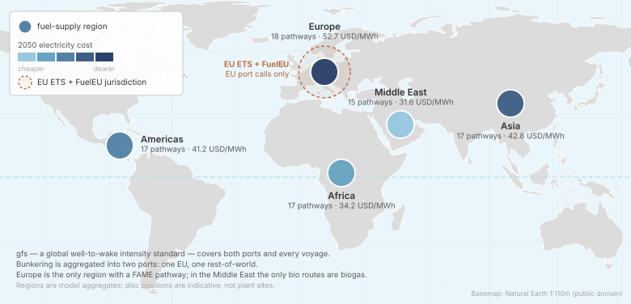
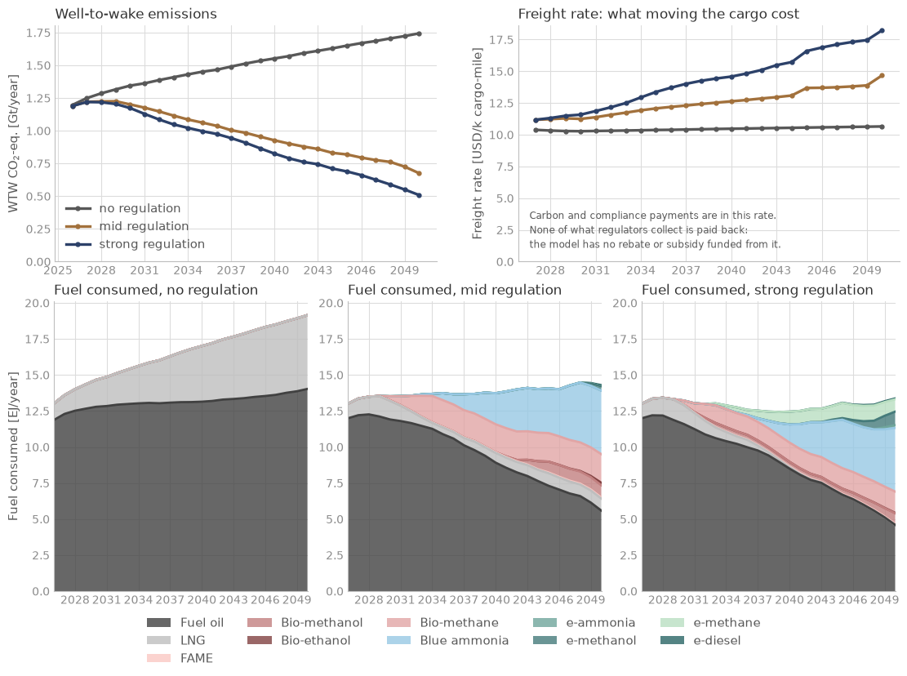

<!--
SPDX-FileCopyrightText: 2026 Fonden Mærsk Mc-Kinney Møller Center for Zero Carbon Shipping
SPDX-License-Identifier: CC-BY-4.0
-->

# The world fleet

[Global cases](global-cases.md) · decks `simulations/scenarios/` · the case of
[Session 2](../workshop/02-run-a-global-case.ipynb)

[](https://colab.research.google.com/github/zerocarbonshipping/navigate-zcs/blob/workshop-colab/docs/workshop/02-run-a-global-case.ipynb)

What does the world fleet burn to 2050 under a global fuel standard?

## The case



- **Ships:** the whole international fleet as the data library describes it,
  twenty-three classes on the library's global operating profiles.
- **Fuels:** fuels made in five supply regions, from the library's plants,
  producers and feedstocks.
- **Policy:** three scenarios: no regulation; EU ETS and FuelEU with a moderate
  global fuel standard (mid); the same with a strict one (strong). A fourth,
  business as usual, keeps the EU measures only and splits each class into an
  international and a domestic fleet.
- **Horizon:** 2026 to 2050. A yearly run takes about 25 minutes; the
  `workshop_whatif/` copies run on a coarse time grid in a few minutes.

These scenarios test the model across degrees of regulation. They are not the
Center's view of likely futures.

## Results



Without regulation emissions keep rising with trade; under the mid and strong
standards they fall to well under 1 Gt CO2e a year by 2050, with LNG, biofuels
and blue ammonia taking over from fuel oil. [Session 2](../workshop/02-run-a-global-case.ipynb)
draws this figure and lets you move the scenarios' assumptions.

## The deck

The decks are almost entirely `Load` statements: every node comes from the data
library's modules.

:::::{tab-set}

::::{tab-item} basecase_mid_regulation.nav
```{literalinclude} ../../simulations/scenarios/basecase_mid_regulation/basecase_mid_regulation.nav
:language: python
```
::::

::::{tab-item} mid_regulation.inc
```{literalinclude} ../../simulations/scenarios/0_includes/mid_regulation.inc
:language: python
:caption: 0_includes/mid_regulation.inc
```
::::

::::{tab-item} strong_regulation.inc
```{literalinclude} ../../simulations/scenarios/0_includes/strong_regulation.inc
:language: python
:caption: 0_includes/strong_regulation.inc
```
::::

::::{tab-item} Coarse grid
```{literalinclude} ../../simulations/scenarios/workshop_whatif/workshop_basecase_mid_regulation.nav
:language: python
:caption: workshop_whatif/workshop_basecase_mid_regulation.nav
```
```{literalinclude} ../../simulations/scenarios/workshop_whatif/includes/time_steps_coarse.inc
:language: python
:caption: workshop_whatif/includes/time_steps_coarse.inc
```
::::

:::::

## Build it with an AI assistant

This is the model of the global family: a case on the world fleet, or on a
policy applied worldwide, starts from its full prompt.
[Session 5](../workshop/05-build-your-own-case.ipynb) shows how to use it.

::::{dropdown} Full prompt: Session 2's reference scenario
```{include} ../workshop/prompt-bank.md
:start-after: <!-- bank:world-fleet -->
:end-before: <!-- /bank:world-fleet -->
```
::::

### Variants

::::{dropdown} A global study: the cost of waiting
```{include} ../workshop/prompt-bank.md
:start-after: <!-- bank:cost-of-waiting -->
:end-before: <!-- /bank:cost-of-waiting -->
```
::::

::::{dropdown} The world fleet, simplified: the global picture at a size you can iterate on
```{include} ../workshop/prompt-bank.md
:start-after: <!-- bank:world-simplified -->
:end-before: <!-- /bank:world-simplified -->
```
::::

## Run it yourself

In Colab: [Session 2](https://colab.research.google.com/github/zerocarbonshipping/navigate-zcs/blob/workshop-colab/docs/workshop/02-run-a-global-case.ipynb).
On your machine, from the repository root:

```bash
python -m navigate simulations/scenarios/workshop_whatif/workshop_basecase_mid_regulation.nav -d ./assumptions
```

To install Navigate, follow the [installation steps in the README](https://github.com/zerocarbonshipping/navigate-zcs/blob/dev-workshop/README.md#installation),
or the more detailed [Getting started](../tutorials/getting_started.md) tutorial.
