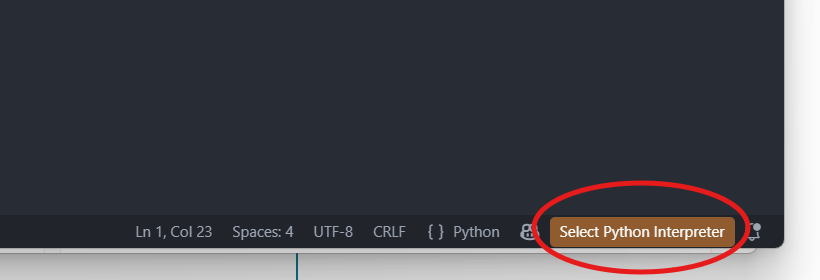
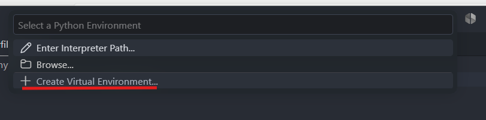

<!--
SPDX-FileCopyrightText: 2026 Fonden Mærsk Mc-Kinney Møller Center for Zero Carbon Shipping
SPDX-License-Identifier: CC-BY-4.0
-->

# Setting up Navigate
This is a beginner-level tutorial. The normal installation procedure for developers is mentioned in the `README.md`.

Navigate can be run through a number of different editors, environments and IDEs since it is just a Python package. In this tutorial, we will showcase using Visual Studio Code (VS Code) as it keeps the usage streamlined throughout operating systems and holds everything you need in one place.

## Prerequisites

- Python 3.13
- Visual Studio Code 

On Windows, these programs can be downloaded without administrator privileges through the Microsoft Store. 

## Downloading the Software

Download **Source code (zip)** from the latest Navigate release:

```{button-link} https://github.com/zerocarbonshipping/navigate-zcs/releases
:color: primary

Go to the Navigate releases
```

Extract the archive, rename the extracted project folder (the one containing `pyproject.toml`) to `navigate-zcs`, and move it to the location where you want to work.

You may also clone the repository or run `pip install navigate-zcs`; however, the latter will not give you access to the full documentation and support files.

## Installation and Setup

1. Open VS Code and open the `navigate-zcs` folder in VS Code. 

2. Install the Python extension. Click *Extensions* in the left sidebar, search for `python` and install **Python** by Microsoft. VS Code needs it to create and use a virtual environment.

   ```{image} ../_static/vscode_sidebar.png
   :alt: The Python extension in the Extensions view
   :scale: 70%
   ```

3. Create a virtual environment: a Python installation for Navigate alone, so that its packages do not mix with those of your other Python projects. Open any Python file, for example `navigate/__init__.py`, and click **Select Python Interpreter** (or the Python version shown in its place) at the bottom right of the window.

   

   Select **Create Virtual Environment...** and follow the prompts, choosing Python 3.13 when asked. VS Code creates a `.venv` folder in `navigate-zcs` and uses it from then on.

   

4. Open up a new terminal in VS Code (see top menu bar). Its prompt starts with `(.venv)`, which shows that the virtual environment is active.

5. Install the package:

   ```bash
   pip install .
   ```

This tutorial also lives in the repository, under `docs/tutorials/`. You can open it and read along from there if you prefer.

Before running a tutorial, download its files using the button on its page and extract the `tutorial_X` folder into the `navigate-zcs` folder opened in VS Code. In VS Code's Explorer, right-click the extracted tutorial folder and select **Open in Integrated Terminal**. Run that tutorial's `navigate` commands in this terminal rather than in the repository-root terminal used for installation.

### Assumptions – Defaults and Modules

*These are not needed for the tutorial simulations, however...*

Most of the Center's larger simulations use a set of pre-configured input files from the `assumptions/` folder. When running Navigate and loading these modules, the location of the folder has to be known. This can be done once or with every run. 

To permanently link the assumptions, do the following:

::::{tab-set}
  :sync-group: os

  :::{tab-item} Windows
  :sync: windows

  Press Windows+R and paste the following to open the environment variables window:

  ```
  rundll32 sysdm.cpl,EditEnvironmentVariables
  ```

  1. Under *User variables*, click *New...*
  2. Enter `ASSUMPTIONS_DATA_DIR` as the variable name.
  3. Enter the full path to the `assumptions` folder as the variable value, e.g.
  `C:\path\to\navigate-zcs\assumptions`. *Browse Directory...* lets you pick it.
  4. Click *OK* in both windows.

  Restart VS Code so that its terminal picks up the new variable.
  :::

  :::{tab-item} Mac/Linux
  :sync: unix
  
  In a terminal, run the following command after changing the path.
  ```bash
  echo 'export ASSUMPTIONS_DATA_DIR="/__YOUR__PATH__HERE!__/navigate-zcs/assumptions"' >> ~/.zshrc
  ```

  On Linux, use `~/.bashrc` instead of `~/.zshrc`. Open a new terminal afterwards.
  :::

  ::::

## Setting up Syntax Highlighting (Optional but recommended)

Syntax highlighting shows keywords in the Navigate language in different colors, so that writing `.nav` and `.inc` files becomes easier.

```{button-link} navigate-language.vsix
:color: primary

Download the VS Code extension
```

1. In the left sidebar, click extensions.
2. Still in the sidebar, on the top, click `...`
3. Select *Install from VSIX*
4. Find and select the downloaded `navigate-language.vsix`

## Checklist

- Navigate downloaded and open in VS Code (or an editor of your choice)
- Navigate installed through the terminal (leave the terminal open)
- For your convenience, syntax highlighting set up.

For reference, here is the file structure you should be seeing in your VS Code file explorer.

```
Navigate/
├── README.md
├── assumptions/
│   ├── defaults/
│   └── modules/
├── docs/
│   └── tutorials/        <- the tutorial texts, including this guide
├── navigate/
├── simulations/
├── syntax/
├── pyproject.toml
└── ...other files...
```

Each tutorial page has a download button at the top. It holds the folder `tutorial_X` with skeleton `.nav` and `.inc` files to fill in and everything else you might need for that tutorial.

An example solution is at the bottom of each tutorial page.

