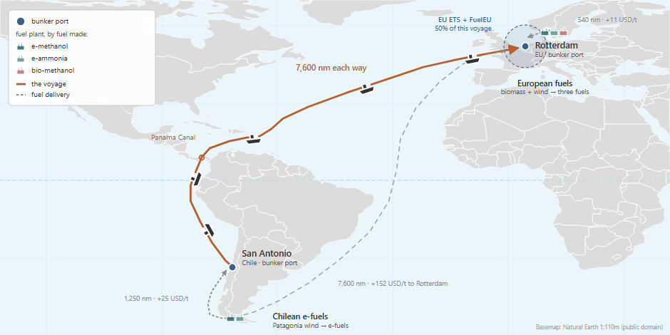
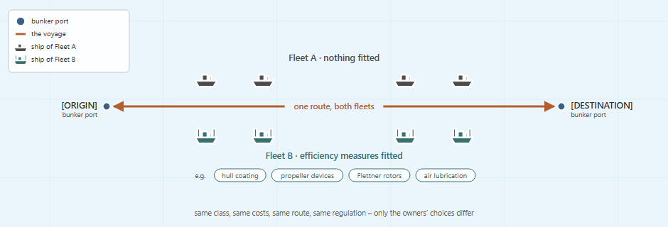
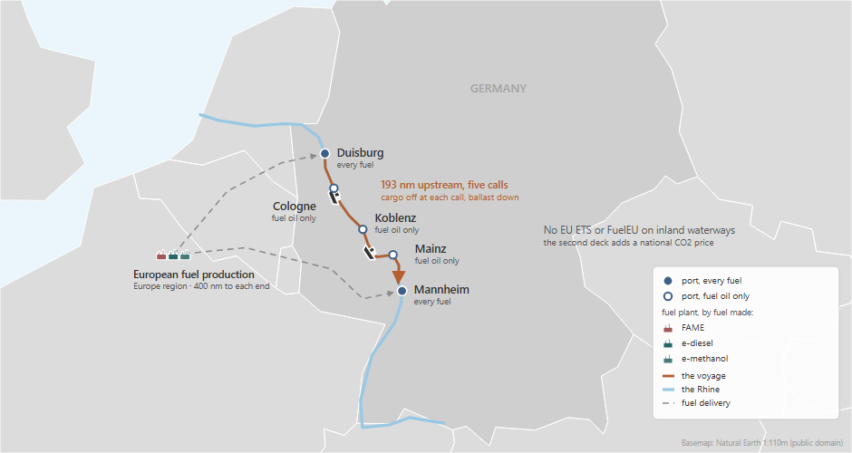
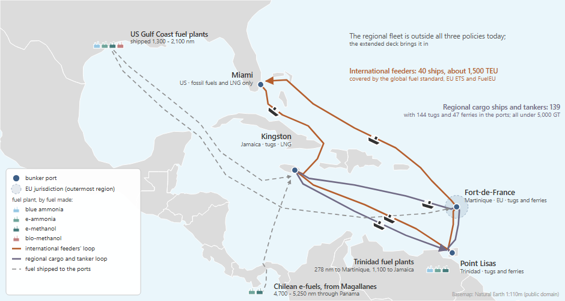

<!--
SPDX-FileCopyrightText: 2026 Fonden Mærsk Mc-Kinney Møller Center for Zero Carbon Shipping
SPDX-License-Identifier: CC-BY-4.0
-->

# Prompt bank

Each entry is a full prompt for one kind of study, tested by handing it to an AI
assistant with no other instructions and checking the deck it built. Pick the
entry closest to your case, change what differs, and give it to your assistant.
The rules every deck shares are in [Building a deck with an AI
assistant](building-a-deck.md); the prompts here only describe their case.
Every entry models a market segment owned by many companies, in hundreds of
ships or a share of a library class, never one company's fleet or a single ship.

[Session 5](05-build-your-own-case.ipynb) teaches the process on one case, Session 1's
copper trade, and shows a global and a regional case as cards. This bank holds
every tested prompt, not displayed on the site, so that assistants can start
from the closest one and the prompts can be improved as more people build
decks. The start-up prompt of Session 5 reads the index below.

## Index

One line per prompt, Session 5's included, grouped by family. A new entry adds
its line here, in its family. The families are those of Session 5: specific
routes (one trade between two or three named ports), global cases (the world fleet
or a worldwide policy, from the library's modules), and regional cases, with a
domestic fleet (a country's or a region's own ships under a national or
regional policy). Each family's decks are built the same way, so look first
for an entry of the same family. An entry marked "variant" has no full prompt of its
own: take the full prompt of the entry it names, and change what its list of
differences says. Everything the list does not change comes from that full
prompt.

| Family | Entry | The question it answers | Scale | Ships | Policy | What the case changes | Tested |
|---|---|---|---|---|---|---|---|
| Specific routes | Session 1's copper trade: one long trade under EU rules (worked through in Session 5) | Which fuels do owners choose on one long trade under EU policy? | One long trade: Chile to Rotterdam | 300 Panamax bulk carriers | EU ETS and FuelEU on half the voyage | One run: the fuel choice under policy | 2026-10-19 |
| Specific routes | One trade, two ports: what the model does when nothing pushes it (variant) | What does the model do on one trade when nothing pushes it? | One trade: Saudi Arabia to China | 200 Suezmax tankers | None | Nothing: the fuel choice on cost alone | 2026-10-26, through the start-up prompt |
| Specific routes | LNG carriers from Qatar to Japan: which fuel wins on cost alone (variant) | Which fuel wins on cost alone on a gas-carrier trade? | One trade: Ras Laffan to Futtsu | 100 gas carriers | None | Nothing: the fuel choice on cost alone | 2026-10-26 |
| Specific routes | EU short-sea feeders: what EU ETS and FuelEU make the owners do (variant) | How do owners comply with EU ETS and FuelEU, and at what cost? | One trade, both ports in the EU: Rotterdam to Gothenburg | 1,500 TEU feeders | EU ETS and FuelEU on the whole voyage | A policy: with and without it | 2026-10-19 |
| Specific routes | Green finance: do cheaper loans bring zero-emission ships forward? (variant) | Do cheaper loans bring zero-emission ships forward? | One trade: Tubarão to Rotterdam | Panamax ore carriers | EU ETS and FuelEU on half the voyage, in both runs | Finance: cheaper cost of capital for ammonia and methanol ships | 2026-10-19 |
| Specific routes | Two fleets, one market: what the owners' efficiency choices are worth (variant) | How much do the owners' efficiency choices matter on the same trade? | One trade of your choice | Two fleets of one class | Your choice | Technology: with and without it | ran first time; criteria not checked |
| Global case | Session 2's reference scenario: the world fleet from the library's modules | What does the world fleet burn to 2050 under a global fuel standard? | The world | The library's whole fleet | EU ETS, FuelEU, global fuel standard | One run: no comparison | 2026-10-19 |
| Global case | A global study: the cost of waiting (variant) | What does starting a global fuel standard late cost? | The world | The library's whole fleet | Global fuel standard, EU ETS, FuelEU | Timing: the standard on time vs delayed | 2026-10-26 |
| Global case | The world fleet, simplified: the global picture at a size you can iterate on (variant) | What does a cut-down world fleet do under EU policy? | The world, two or three classes | Library fleets | EU ETS and FuelEU | One run: no comparison | ran first time; criteria not checked |
| Regional case, with a domestic fleet | Inland waterways in Germany: what a national CO2 price does | Does a national CO2 price move owners to drop-in fuels or new engines? | One river trade in Germany | 300 Rhine cargo vessels | National CO2 price (a copied EU ETS Regulation) | A price: with and without it | 2026-10-16 |
| Regional case, with a domestic fleet | Caribbean shipping under global and EU rules | How are a region's own ships affected by global and EU rules, today and if extended to them? | A region: the Caribbean | 330 regional ships and 40 feeders | Global fuel standard (two tiers), EU ETS, FuelEU | Coverage: the feeders only, then the regional ships too | 2026-10-28, built cold |
| Regional case, with a domestic fleet | Coastal shipping in Norway: two ship classes under a national CO2 tax (variant) | Does a national CO2 tax move owners to biofuels or to new ships? | One coastal trade: Bergen to Tromsø | 100 general cargo ships and 50 ferries | National CO2 tax (a copied EU ETS Regulation) | A price: with and without it; two classes on one trade | 2026-10-26 |

## What "it works" means here

A deck that runs is not yet a deck that answers the question. An entry is marked
as tested only when a cold build passed all of these:

- **It runs**: exit code 0, no errors, and only the warnings
  `building-a-deck.md` lists as coming with the library.
- **Every number is traceable**: it comes from `assumptions/` by name, or it is
  marked INVENTED where it appears and listed in the `.nav` header.
- **The first year is plausible**: an oil fleet's well-to-wake intensity is close
  to 92 gCO2e/MJ, and the energy consumed matches the size of the fleet.
- **The answer moves the right way**: where the case compares runs, the one with
  the stronger push away from fossil fuels does not burn more of them.
- **The question is one Navigate can answer**: see the limits below.

## What the library does not cover

Cases outside these limits can still be built, but their numbers are INVENTED
and the entry says so up front:

- **Vessels**: only seagoing classes. There is no inland vessel and no
  battery-electric or hydrogen fuel-cell power system.
- **Fuels**: no HVO. Biodiesel (FAME) and e-diesel stand in for drop-in fuels.
  The library makes FAME in Europe only.
- **Policy**: EU ETS, FuelEU Maritime and CII only. National measures are built
  with INVENTED values; a carbon price as a copy of the library's `eu_ets`
  Regulation (building-a-deck.md says why not a `Levy`).
- **Geography**: no distances, port handling costs or bunker transport costs.

## Adding your case

The bank grows from the cases people build. When a deck runs, the assistant ends
its report with a **prompt bank entry** (building-a-deck.md says what goes in
it): the index line, the model it took, the case sheet written as the
differences from that model, the test result, and its notes for
building-a-deck.md. Paste it into [a new issue](https://github.com/zerocarbonshipping/navigate-zcs/issues/new?title=Prompt%20bank%20entry%3A%20%3Cyour%20case%3E&body=Paste%20here%20the%20%22Prompt%20bank%20entry%22%20section%20that%20ends%20your%20assistant%27s%20report%3A%0A%0A-%20Index%20line%20%28family%2C%20question%2C%20scale%2C%20ships%2C%20policy%2C%20what%20the%20case%20changes%2C%20built%20on%29%3A%0A-%20Model%20taken%3A%0A-%20Case%20sheet%2C%20as%20the%20differences%20from%20that%20model%3A%0A-%20Test%20result%20%28exit%20code%2C%20warnings%2C%20errors%3B%20first-year%20WTW%20intensity%20and%20energy%29%3A%0A-%20For%20building-a-deck.md%3A%0A).

The workshop authors then:

- add it as a variant of its model, or as a full entry when it needs a structure
  or a fix that no entry has;
- fold its notes into building-a-deck.md, and test the chain again;
- promote a variant that several people build to a full entry.

## Entries

### Session 1's copper trade: one long trade under EU rules

**The study.** 300 Panamax bulk carriers (about 80,000 DWT) carry copper
concentrate from San Antonio, Chile, to Rotterdam via the Panama Canal, 2026 to
2050. They can switch to LNG, methanol or ammonia ships, and fit efficiency
measures; e-fuels are made in Chile or in Europe; EU ETS and FuelEU Maritime cover
half of the voyage. It is the case of Session 1, which Session 5 works through
step by step, and the template of the specific-routes family.



**Tested:** built by handing it to two Claude models (Opus and Sonnet) with no other instructions: both decks ran without warnings or errors, and both came within 0.2 % of the results of Session 1.
Session 5's start-up prompt, carried through on a new case (Handysize bulk
carriers, Vancouver to Yokohama, under the global fuel standard) and taking this
entry as its model, built cleanly first time on Opus, Sonnet and Haiku
(2026-10-28), with the same answer on all three.

````text
You are helping me build and run a simulation deck for Navigate, the shipping decarbonisation model in this repository. Write the files yourself; do not only describe them.

Before writing anything, read docs/workshop/building-a-deck.md in the Navigate
repository and follow it:
it holds the rules every deck follows and the traps earlier builds fell into.
simulations/examples/example_4/ is this case, already built: take its
structure, and the numbers this prompt gives. Where this prompt and the guide
disagree, this prompt wins.

GETTING NAVIGATE RUNNING (do this first)
- Navigate is the repository https://github.com/zerocarbonshipping/navigate-zcs.
  If you were not opened in it, look for it on this machine (a folder usually
  named navigate-zcs, holding README.md, navigate/ and assumptions/), or ask me
  where it is. If it is not on this machine yet, tell me, and propose cloning
  it (or downloading the zip from GitHub). Work from the repository root from
  then on.
- Check whether Navigate is installed, from the repository root:
      python -m pip show navigate-zcs
      python -m navigate --help
  If both work, go on to the deck.
- If not, the installation steps are in README.md (section "Installation"):
  Python 3.12, ideally in its own environment (venv or conda), then
      python -m pip install .
  from the repository root. The README also has the fixes for the two common
  Windows errors (PowerShell refusing to activate a venv, and pip.exe "Access is
  denied"). A slower, beginner's walk-through with VS Code is in
  docs/tutorials/getting_started.md, also online at
  https://zerocarbonshipping.github.io/navigate-zcs/tutorials/getting_started.html
- Show me the commands and wait for my go-ahead before you install, upgrade or
  create anything. No extra solver is needed: Navigate comes with HiGHS. Skip the
  optional Gurobi extra unless I say I have a full Gurobi licence.

HOW NAVIGATE WORKS (read this before writing anything)
- A deck is one .nav file plus the .inc files it includes. The syntax is explained
  in docs/reference_manual/overview.md, and every node type (Fleet, Vessel, Route,
  Port, Fuel, Plant, Producer, Regulation, ...) has its own page in
  docs/reference_manual/.
- assumptions/ is the data library. `Load DefaultCalibration` reads the module file
  assumptions/modules/installation/default_calibration.inc. `Import Fuel "methanol_bio"`
  reads one node from assumptions/defaults/installation/Fuel/methanol_bio.inc.
  `Copy Vessel "a" "b"` imports node "a" from the library under the new name "b".
- simulations/examples/example_1 to example_4 are complete decks that run: read
  them for syntax.
- Run a deck from the repository root, in the Python environment where Navigate
  was installed from this repository, with:
      python -m navigate <path to the .nav file> -d ./assumptions
  (`python -m navigate` run from the repository root always uses this
  repository's code; the shorter `navigate` command may point to another copy.)
- A run writes a .log file next to the .nav. The end of the .log has a "Log
  summary" table with the number of warnings and errors. Built as described
  here, this deck runs with no warnings at all: report any you get. `Load DefaultPlot` in the
  .nav DEFINE block also writes the charts to plots/ and plots_analysis/.
  If you cannot run terminal commands, give me the exact command, wait for me to
  paste back the end of the output, and fix whatever it reports.
- To get results as numbers, add `Load DefaultReport` to the .nav DEFINE block.
  The run then also writes plots/<deck name>_report_default.xlsx. Its "Global"
  sheet has one row per year, one ConsumedEnergy column per fuel (GJ per year;
  the fuel name is in the third header row) and the fleet's emissions
  (TotalEquivalentWTW, t CO2e per year).

THE DECK
Build it in a new folder, simulations/user/my_simulation/, with the .nav file
my_simulation.nav and one .inc file per topic in includes/. If that folder
already exists, use my_simulation_2 (then _3, ...) instead, and tell me which.
Write nothing outside that folder: do not change, move or delete any file that
is already in the repository.

THE CASE
Panamax bulk carriers (~80,000 DWT) carrying copper concentrate from San
Antonio, Chile, to Rotterdam via the Panama Canal, 2026 to 2050, yearly steps.
The fleet starts entirely on fuel oil. The model decides which fuel to bunker
and where, how fast to sail, which ships to retrofit or order, and which
efficiency measures to fit. Fuel producers decide where to build plants.

1. Fleet (one Fleet node, "copper_trade")
   - Four ship designs, copied from the library's vessels for this class:
     bulk_carrier_80k_dwt_ice_oil, _ice_methane, _ice_methanol and _ice_ammonia,
     renamed ship_oil, ship_lng, ship_methanol and ship_ammonia.
   - 300 ships in 2026 (INVENTED: about 8 % of the world Panamax fleet), all
     ship_oil, with the library's age distribution for the oil ship
     (Curve("age_dist_bulk_carrier_80k_dwt_oil")) and zero for the other three.
   - No orderbook (leave Orderbook out): the library's is sized for the whole
     world fleet.
   - Trade growth: the library's Forecast("trade_growth_bulk_carrier").
   - Retrofits: the three conversion costs in
     assumptions/defaults/installation/Fleet/bulk_carrier_80k_dwt.inc (oil to
     methanol, oil to ammonia, LNG to ammonia), restated for the new ship names.
   - Speed management: as the same Fleet file sets it (AllowSpeedManagement,
     MaximumSpeedChange).
   - Efficiency measures: the seven library technologies for this class (the
     files ending in _bulk_carrier_panamax in
     assumptions/defaults/installation/Technology/). Start each at the library's
     uptake curve (Curve("uptake_<technology name>")) where one exists. Two
     have none: leave their initial share unset, which means zero (a plain 0
     is rejected, it must be a Curve). Set TechnologyCostOfCapital =
     Variable("cost_of_capital_vessel").

2. Route
   - ROUND_TRIP between San Antonio and Rotterdam, sailing laden out and in
     ballast home (capacity utilisation 1 then 0).
   - 7,600 nautical miles each way (INVENTED: the library has no distances).
   - Speeds and days in port from the library's operational profile for this
     class, assumptions/defaults/installation/Route/operational_profile_bulk_carrier_80k_dwt.inc:
     the most common speed (the one with the largest ConditionDistribution
     share, laden and ballast alike), and days in port per call = (1 - TimeAtSea) x 365 / total
     port calls per year. Show that arithmetic in a comment.
   - Do not use the profile's abstract ports (port_global, port_europe): the two
     ports are your own nodes, san_antonio and rotterdam.

3. Fuels and where they come from
   - Fuel oil and LNG: global commodities. Bunkerable at every port, priced with
     the library's global price forecasts and given the library's upstream (WTT)
     emissions, both as bunker overwrites on the ports. No plant, producer or
     logistics chain for them.
   - E-methanol and e-ammonia: library plants on alkaline electrolysis, on
     dedicated renewable power. One plant of each in the "americas" region
     (Chile) and one of each in "europe". The European ones are Copy Plant of the
     library plants, because the imported ones already carry the library names.
     The library Plant files carry no region or power source: set Region and
     Source on every plant yourself.
   - Bio-methanol: the library's gasification plant, in europe only, on grid power.
   - Give every plant the library's cost of capital for its kind and region,
     as assumptions/modules/installation/default_plant.inc does
     (Forecast("cost_of_capital_plant_electro_americas"), ..._electro_europe,
     ..._bio_europe). Import Plant does not bring it, and a plant without one
     is silently financed at 0 %.
   - All three alternative fuels can be bunkered at both ports.
   - Regions: declare "americas" and "europe" yourself, with the electricity
     cost and grid emission lines of the library's Region files. Do not Import
     them: they also price feedstocks this deck does not have, and the parse
     fails. The production economics (feedstock costs, process capex,
     opex, energy, lifetimes) are the library's, as
     assumptions/modules/installation/default_region.inc sets them for every
     region: restate only the lines for the processes and feedstocks your plants
     use. Within a region, fuel moves by truck at zero cost, with the library's
     truck emissions.
   - Two producers: one owns the four e-fuel plants, one owns the bio-methanol
     plant. Each may build up to Forecast("epc_global_capacity_mid") x
     Forecast("epc_global_share_shipping") a year.
   - Feedstock ceilings: the library's availability x its shipping share x a
     trade share, as set_feed_constraint on the producer that uses it:
       biogenic CO2 (e-methanol), trade share 0.003 (INVENTED). Hold its pool
         flat at the library's 2026 value: declare Forecast
         "carbon_dioxide_biogenic_availability_flat", 91.55e6 t a year from
         2026 to 2050 (INVENTED), and use it in place of the library's
         carbon_dioxide_biogenic_availability, which grows to 350e6 by 2050.
       gasifiable biomass (bio-methanol), trade share 0.01 (INVENTED)
     The library's shares are for all of shipping; this deck is 300 ships on one
     trade.

4. Bunkering costs (all INVENTED; BunkerLogistics takes plain numbers)
   - Distance from production region to port, nautical miles:
       americas to san_antonio 1,250, americas to rotterdam 7,600,
       europe to rotterdam 540, europe to san_antonio 7,600
   - Transport cost 0.02 USD per ton per nautical mile, for every fuel.
   - Handling cost at the port, USD per ton: fuel oil 8, LNG 15, methanol (both
     kinds) 18, ammonia 25.

5. Regulation: EU ETS and FuelEU Maritime
   Write both Regulation nodes yourself from the library's
   assumptions/defaults/installation/Regulation/eu_ets.inc and fuel_eu.inc:
   keep their settings, global warming potentials and EU default emission
   factors, but only the lines for this deck's five fuels. Change one thing: the
   jurisdiction is Port("rotterdam") instead of port_europe. Both legs (the sailings out and
   back) then count at the inter-jurisdiction fraction (half the voyage), Rotterdam's port
   stays count in full and San Antonio's not at all. Under FuelEU, do not set a
   WTT value for e-methanol or e-ammonia: Navigate then calculates it from their
   production chain.

6. The rest of the DEFINE block
   Load DefaultModelDefinition first and DefaultEmission with the fuels. Load
   DefaultCalibration after your own includes: it sets the decision behaviour
   with wildcards (Fleet "*", ...) that only match nodes already declared.
   Then DefaultReport and DefaultPlot. EVENTS: Load DefaultTimeStepYearly.

PITFALLS (each cost someone time before)
- Do not put two plants making the same fuel in the same region under one
  producer: the bunkering solve stalls for minutes on one year. A normal run of
  this deck takes one to two minutes with the plots; if it runs past ten, stop
  it and tell me.
- A node must exist before another node or a command refers to it. So the
  include order is: fuels, then sources, feedstocks, processes and
  Import Transport "truck", then the regions, then the plants, then the
  producers. Likewise, a wildcard such as Vessel "ship_*" { Route = ... } only
  matches ships already copied, so put it after the Copy Vessel lines.

NUMBERS
Every number must come from assumptions/ and be referenced by name
(Forecast("..."), Curve("..."), Variable("...")), never copied in as a literal.
Where the library itself stores a plain number (the fuel-conversion costs in a
Fleet file, the time at sea in a Route file), copy it with a comment naming the
file it came from. The values marked INVENTED above are the only numbers that
are not from the library: mark each one INVENTED in a comment where it appears
and list them all in the .nav header.

DECK RULES
The .nav DEFINE and EVENTS blocks accept only Include and Load. Every node
declaration, Import and Copy goes in an .inc file that they include.

BEFORE YOU TELL ME IT WORKS
Run it (or have me run it) as above. Report the exit code and the warning and
error counts from the Log summary. Then, from the report, tell me:
- the fleet's well-to-wake emissions in 2026 and in 2050 (kt CO2e per year), and
  summed over 2026-2050;
- the share of alternative fuels (everything but fuel oil and LNG) in the
  energy consumed in 2050;
- the three biggest fuels in 2050.
For comparison, the workshop's own deck for this case gives 5,935 kt in 2026,
3,541 kt in 2050, about 127,800 kt in total and 38.5 % alternative fuels in 2050, with
fuel oil, e-ammonia and LNG the three biggest fuels. Say
how close you are, and if you are far off, what in your deck could explain it.
````

### One trade, two ports: what the model does when nothing pushes it

**Variant of "Session 1's copper trade" above.** 200 Suezmax crude tankers (about 127,000
DWT), about a tenth of the world fleet of that class and owned by many
companies, on one named route, from Ras Tanura in Saudi Arabia to Ningbo in
China, sailing laden out and in ballast home. They start on fuel oil. LNG and
fuel oil are bought on the world market, while e-ammonia and e-methanol can be
made in the Middle East on dedicated solar and wind power. No regulation applies
at all, so every fuel choice is made on cost alone: the case shows what the
model does when nothing pushes it.


*Ras Tanura to Ningbo: one route, Middle East e-fuels, no regulation.*

**Build it from the full prompt of "Session 1's copper trade", with these differences:**
- Folder `simulations/user/gulf_asia_tanker/`, one deck.
- Fleet: the library's `tanker_127k_dwt` class, 200 ships (INVENTED: about 9 % of
  the library's 2,255), all on fuel oil at the start.
- Route: Ras Tanura to Ningbo, laden out and in ballast home, with the class's
  own values from `operational_profile_tanker_127k_dwt.inc`.
- Fuels: fuel oil and LNG as global commodities; e-ammonia and e-methanol made in
  the Middle East (the library's `middle_east` region).
- No regulation: do not load DefaultRegulation. Leave the energy-efficiency
  technologies out.
- Report the fuel mix in the first year and the last, and whether anything
  switched.

**Tested:** 2026-10-26, through Session 5's start-up prompt, when it was one of
Session 5's examples; the full prompt that passed is in the repository's history, commit `02d96755`. Folded into a variant on 2026-10-28: not yet built from the variant.

### Two fleets, one market: what the owners' efficiency choices are worth

**Variant of "Session 1's copper trade" above.** No specific geography: one route that you choose, sailed by two fleets of the same vessel class in the same market, with the same costs, the same fuels and the same regulation. Fleet A's owners fit no energy-efficiency measure. Fleet B's owners fit the technologies the library offers for that class (hull coatings, propeller devices, rotor sails, air lubrication and so on). Whatever separates the two fleets by 2050 (fuel mix, emissions, freight rate, fuel and compliance bill) comes from that one difference.



*One route, two fleets: the only difference is what Fleet B's owners fit.*

**Build it from the full prompt of "Session 1's copper trade", with these differences:**
- Folder `simulations/user/<your folder name>/`, one deck. The route, the vessel
  class, the fuels that compete and the regulation (EU ETS and FuelEU, or none)
  are the user's choice; the fleet size is [N] ships per fleet (INVENTED: each
  stands for many owners, so hundreds of ships).
- Two Fleet nodes of the same class sharing one Route, with the same costs,
  fuels and regulation. Follow `simulations/examples/example_3/`'s pattern of
  one "regular" and one "efficient" fleet, for this one class.
- Fleet A's owners fit nothing at all: leave out its Fleet file's
  `set_initial_technology_share` lines and set `AllowTechnologyApproximation =
  FALSE`, as example_3's regular fleet does. Fleet B fits the technologies the
  library offers for the class.
- Use the library's own Fleet file for the class, with its technology list and
  retrofit costs.
- A Report per fleet: FuelTypeEnergy, TotalEquivalentWTW, FuelExpenses and
  RegulationExpenses, and per vessel InvestmentFreightRate.
- Report, instead of the template's comparison: what separates the two fleets by
  2050 (fuel mix, emissions, freight rate) and how much fuel and compliance cost
  the efficient fleet saved. This version of Navigate does not report what the
  measures themselves cost: say so, rather than concluding they paid for
  themselves.

**Tested:** ran first time as a full prompt; the criteria above were not
checked. It was one of Session 5's examples until 2026-10-28; the full prompt that passed is in the repository's history, commit `02d96755`. Folded into a variant on 2026-10-28.

### Inland waterways in Germany: what a national CO2 price does

**The study.** Dry-cargo motor vessels on the Rhine between Duisburg and
Mannheim, 2026 to 2050, run twice: without policy, and with a CO2 price on the
fossil fuel they burn, standing for Germany's national CO2 price. The price is a
copy of the library's EU ETS regulation moved to the two German ports, so only
its price path is invented. The question
is whether that price moves the owners to drop-in fuels (biodiesel, e-diesel) in
the ships they have, or to new engines.

**What comes from the library.** The engines, tanks and fuel options of the
library's general cargo ships, the fuels and their prices, and the European fuel
production.

**What is INVENTED.** The library has no inland vessel, so the ship is a library
general cargo ship resized for the Rhine: its capacity, power, propulsion curve,
price and lifetime are placeholders. The route, fleet size, bunker logistics and
the CO2 price path are invented too. Replace the placeholders with sourced data
before quoting any result.

**Limits.** Navigate has no river current, locks or low-water periods, and no
battery-electric ship, which is one of the options German inland operators are
actually weighing.

**Tested:** 2026-10-16. The final prompt passed every check above on the first
attempt, built cold and also through Session 5's start-up prompt from a different
inland case (container barges from Duisburg to Frankfurt). Three earlier rounds
found the traps now written in `building-a-deck.md`. Both builds found that at 65
to 150 USD/t the owners pay the price rather than switch fuel, and order a few
more LNG ships; the drop-in fuels need roughly 440 USD/t (biodiesel) to 800-1,100
USD/t (e-diesel). Treat that as a property of the placeholders, not of the Rhine.
2026-10-26, as the model a start-up prompt chose for a different case (Norwegian coastal cargo ships and ferries under Norway's CO2 tax): the chain built and ran cold with no warnings, and found the same: biofuels need roughly 440 USD/t, and the owners pay the tax, order a few more LNG ships and slow down.



It was one of Session 5's examples until 2026-10-28.

````text
You are helping me build a simulation study for Navigate, the shipping
decarbonisation model. Write the files yourself; do not only
describe them.

Before writing anything, find the Navigate repository on my machine (a folder
usually named navigate-zcs; ask me where it is if you cannot find it), then read
docs/workshop/building-a-deck.md in it and follow it. It
says how Navigate works, how to run a deck and read its results, and the rules
every deck follows. This prompt gives the case.

THE DECKS
A new folder, simulations/user/rhine_inland/, holding two decks that differ in
one Include line only:
- reference.nav: no policy at all
- co2_price.nav: the same, plus includes/co2_price.inc

THE CASE
Inland dry-cargo shipping on the Rhine within Germany, 2026 to 2050, yearly steps.
- Fleet: large Rhine motor cargo vessels, all on fuel oil at the start. The
  owners can keep their ships, burn a drop-in fuel in them, or order ships with
  LNG or methanol engines. No ammonia ships: they are not realistic on inland
  waterways.
- Trade: Duisburg to Mannheim, laden upstream, back in ballast.
- Fuels: fuel oil and LNG at their library prices, biodiesel (FAME) and e-diesel,
  which burn in the oil engines, and e-methanol, all made in Europe.
- Policy: none in reference.nav. EU ETS and FuelEU Maritime do not cover inland
  waterways, so do not load DefaultRegulation in either deck. co2_price.nav adds
  Germany's national CO2 price as a copy of the library's EU ETS regulation:
  Copy Regulation "eu_ets" to "co2_price_germany", with its Jurisdiction set to
  the two ports and its RemedialCost set to the CO2 price below. Keep the rest of
  it: it already counts biofuels and e-fuels as zero CO2. It names fuels this case
  does not use (bio-methanol, bio-methane, e-methane, blue and e-ammonia), so
  import those too, in both decks, or it will not parse. building-a-deck.md says
  why this is a Regulation and not a Levy.

HOW TO BUILD IT
The library has no inland vessel. Build the ships from the library's general
cargo vessels (general_cargo_ice_oil, _ice_methane, _ice_methanol) with Copy
Vessel, and resize them for the Rhine with the placeholder values below. A
vessel's engine power sits in its Converter nodes, which its PowerSystem names,
so give each copied vessel its own copies of those, with the new power. Keep the
library's tanks, fuel options and machinery costs, and say in the .nav header
that the fuel-system and tank costs are a seagoing ship's. Ships cannot be
converted to another fuel: leave the library's set_fuel_conversion_cost out. Set
AllowSpeedManagement = FALSE: on a river the waterway sets the speed, and with it
on, the ships drift faster than the speeds below.

Build the rest as building-a-deck.md describes for a deck on named ports: the
Fleet node, a ROUND_TRIP route between your own ports duisburg and mannheim, the
bunker logistics, the European production region and the producers. For the
producers, use the library's plants for FAME, e-diesel and e-methanol in Europe,
with the shares of the library's feedstock ceilings given below.

NUMBERS
Everything not listed here comes from the library, by name. These are
placeholders, INVENTED for this case: mark each one where it appears, list them
all in both .nav headers, and keep them in one file, includes/placeholders.inc,
as Variables, Curves and Forecasts, so a user can replace them in one place. The
route distance and the bunker logistics take plain numbers only: write those in
their own files, marked INVENTED, and list them in placeholders.inc as comments.
- Fleet: 300 ships in 2026, aged evenly from 0 to 39 years, so about one in
  forty retires each year
- Ship: 3,000 t capacity, 40-year lifetime, 6 M USD newbuild price for the hull,
  1.5 MW propulsion power
- Propulsion power at speed, MW: 4 kn 0.25, 6 kn 0.6, 8 kn 1.1, 9 kn 1.45
- Auxiliary power: 0.1 MW at sea and 0.05 MW in port, with 0.2 MW generators
  (the library's are a seagoing ship's)
- Route: 190 nm each way; 7 kn laden upstream, 8 kn in ballast downstream (speed
  through the water; Navigate has no river current); one day in port per call
- Feedstock: this fleet's share of the library's shipping share, 0.02 of the
  used cooking oil and 0.02 of the biogenic CO2
- Bunker logistics: 400 nm from the European plants to each port, 0.03 USD per
  ton per nm
- CO2 price: 65 USD per t CO2 in 2026, rising linearly to 150 USD in 2050

BEFORE YOU TELL ME IT WORKS
Run both decks one after the other and report on each as building-a-deck.md
says. Then, from the two reports, give me side by side:
- the share of energy by fuel in 2026, 2035 and 2050;
- the fleet's well-to-wake emissions in 2026 and 2050, and summed over 2026-2050;
- the ships of each kind in 2050, and what the CO2 price cost the owners
  (RegulationExpenses).
Say plainly what the CO2 price changed: more drop-in fuel in the same ships, new
engines, both, or nothing. If the drop-in fuels never compete, work out from the
bunker prices roughly what CO2 price they would need. Remind me which inputs are
placeholders.
````

### Caribbean shipping under global and EU rules

**A region's own ships, and rules that do not reach them yet.** 330 domestic and intra-Caribbean ships (tugs, ferries, general cargo ships and small tankers), nearly all under 5,000 GT, and 40 container feeders on a Miami - Jamaica - Trinidad - Martinique loop, 2026 to 2050. New fuels are made in Trinidad, on the US Gulf Coast or in Chile, and shipped in. Three decks: no policy; today's rules, a global fuel standard as drafted at the IMO plus the EU ETS and FuelEU with Martinique as the EU port, which cover the feeders only; and the same rules extended to the regional ships. The question is how the region's own ships are affected, today and if the rules reached them.

**Built on public data, with gaps.** The fleet counts come from the IMO CARES report on domestic shipping (2024). The split of the cargo ships, the distances, speeds, delivery costs and the region's share of plant building are INVENTED, and the prompt marks each one. The regional fleet is not calibrated: with the library's world-average ships it burns more fuel than CARES reports, so compare the decks with each other, not with the region's real totals.



**Tested:** 2026-10-28, built cold twice. After the first build the prompt gained
explicit port times, speed management and production pathways; the second build
ran first time with no warnings: the regional ships burnt 418.5 kt in 2026 (CARES:
309 kt), and summed 47.9 Mt without policy against 39.3 Mt with the rules extended
to them. It was one of Session 5's examples until it moved here the same day.

````text
You are helping me build a simulation study for Navigate, the shipping
decarbonisation model. Write the files yourself; do not only
describe them.

Before writing anything, find the Navigate repository on my machine (a folder
usually named navigate-zcs; ask me where it is if you cannot find it), then read
docs/workshop/building-a-deck.md in it and follow it. It
says how Navigate works, how to run a deck and read its results, and the rules
every deck follows. This prompt gives the case.

THE DECKS
A new folder, simulations/user/caribbean/, holding three decks that differ in
their policy Include lines only:
- no_policy.nav: no policy at all
- current_rules.nav: a global fuel standard, the EU ETS and FuelEU, covering
  the international ships only, as today
- extended.nav: the same three, extended to the regional ships too, in
  includes/extend_to_regional.inc, read after the policy files

THE CASE
Caribbean shipping, 2026 to 2050, yearly steps. The question: how are the
region's own ships affected by global and EU policy, today and if the rules
were extended to them?
- Regional fleet: domestic and intra-Caribbean ships, nearly all under
  5,000 GT, so outside all three policies today. 144 tugs and 47 ferries (IMO
  CARES 2024, "Report on Decarbonization of Domestic Shipping: Insights from
  Africa and the Caribbean", p.19), plus 85 general cargo ships and 54 small
  tankers (INVENTED: CARES's other 139 ships, split between the two). Library
  classes tug, ferry, general_cargo and tanker_7500_dwt.
- International fleet: 40 container feeders (INVENTED count) of the library's
  container_1500_teu class; the region's feeders are 500-2,500 TEU.
- Every fleet starts on fuel oil: CARES finds no alternative-fuel ship in the
  region. Leave out the library's orderbooks, which are sized for the world
  fleet. The library's ferry has no ammonia design.
- Ports: jamaica (Kingston), trinidad (Port of Spain and Point Lisas),
  martinique (Fort-de-France, an EU outermost region, so the EU's one port
  here) and miami.
- Routes:
  - tugs work inside the three Caribbean ports: a REGIONAL_TRIP with their
    work split by 2025 container throughput (INVENTED proxy), jamaica 0.78,
    trinidad 0.17, martinique 0.05, and the library profile's 50 port calls a
    year split the same way (39, 8.5, 2.5);
  - ferries: a REGIONAL_TRIP, half in trinidad and half in martinique
    (INVENTED), 25 port calls a year at each;
  - regional cargo ships and tankers: a ROUND_TRIP loop trinidad - martinique -
    jamaica and back, legs 278, 1,021 and 1,100 nm. Cargo ships at 11.2 kn and
    half full on every leg, 2.45 days per port call. Tankers at 10.5 kn
    (INVENTED), full out of trinidad, half full after martinique and empty
    home (INVENTED), 7.4 days per port call;
  - feeders: a ROUND_TRIP loop miami - jamaica - trinidad - martinique and back
    to miami, legs 700, 1,100, 278 and 1,393 nm, at 13 kn (INVENTED), 70 %
    full, 2.5 days per port call.
  The distances are great-circle plus 10 % (INVENTED); miami - jamaica is set
  at 700 nm because the great circle crosses Cuba (INVENTED). The tugs' and
  ferries' speed, time at sea and capacity use come from each class's
  operational profile in the library; the port times above are this case's.
- Speed management as each library class has it: off for tugs and ferries;
  on for cargo ships and tankers (a maximum change of 0.4) and feeders (0.5).
  It can raise a speed above the one set as well as lower it.
- No energy-efficiency technologies: leave the library's out.
- Fuels: fuel oil at every port and LNG at jamaica and miami only (INVENTED),
  both at the library's global prices. Blue ammonia, e-ammonia, e-methanol and
  bio-methanol can be bunkered at the three Caribbean ports, not at miami.
- Fuel production, three sites shipping to the ports:
  - Trinidad, a new region "caribbean": blue ammonia, e-ammonia and e-methanol.
    Renewable power at the library's electricity_cost_americas_mid (INVENTED
    proxy); a grid at 62 USD/MWh (GlobalPetrolPrices, June 2025) and
    0.682 t CO2e/MWh (Ember via Our World in Data, 2024), both held flat
    (INVENTED); natural gas at the library's global price.
  - The US Gulf Coast, the library's "americas" region: the same three, plus
    bio-methanol.
  - Chile, a new region "chile": e-ammonia and e-methanol on the library's
    electricity_cost_americas_low (INVENTED proxy for Magallanes wind).
  E-fuels by alkaline electrolysis, bio-methanol by gasification. Every
  plant's cost of capital is the library's americas forecast for its kind
  (blue, electro or bio): the library has none for the Caribbean or Chile.
- Policy:
  - The global fuel standard, as the IMO Net-Zero Framework was drafted at
    MEPC 83: two regulations that add up, against a reference of 93.3 gCO2e/MJ.
    gfs_tier_1 sets the direct compliance target, -17 % in 2028, -21 % in 2030
    and -43 % in 2035, and charges 100 USD/t CO2e below it. gfs_tier_2 sets the
    base target, -4 %, -8 % and -30 %, and charges a further 280 USD/t below it
    (380 in all). Both start in 2028 and are held flat after their last point
    (INVENTED). Well-to-wake, on intensity, with surplus units pooled freely;
    jurisdiction all four ports; it covers the international ships.
  - The EU ETS and FuelEU: the library's own regulations, imported, with
    martinique as their only port; they cover the international ships. They
    name fuels this case does not bunker (FAME, e-diesel, bio-methane,
    e-methane): import those too, or the deck will not parse.
  - In extended.nav, all four also cover the regional ships.

HOW TO BUILD IT
Build it node by node, as building-a-deck.md describes for a deck on named
ports. Name the vessels and fleets reg_tug, reg_ferry, reg_cargo, reg_tanker
and intl_feeder (vessels reg_tug_oil, ... with Copy Vessel), so that a policy
can cover "intl_*" or "reg_*". Each fleet keeps its library class's age
profile, trade growth and fuel conversion costs. For the second and third
production sites, Copy Plant the first site's plants, each with its own Region,
Source and CostOfCapital. One producer per site, each with the same share of
the library's plant-building capacity and feedstock pools, below. When the new
engines can be ordered: the library's DefaultConverterAvailable dates for each
class, written out for this deck's fleet names. Add a Report with, per fleet,
ExistingVessels, FuelTypeEnergy, TotalConsumedMass, TotalEquivalentWTW,
FuelExpenses and RegulationExpenses; per vessel, ActualSpeed; and per port the
bunker price.

NUMBERS
Everything not listed here or above comes from the library, by name. Mark
every INVENTED number where it appears and list them all in the .nav headers.
- Bunker delivery, nm: Trinidad's plants to trinidad 15, martinique 278,
  jamaica 1,100; the Gulf Coast to jamaica 1,300, martinique 2,000, trinidad
  2,100 (INVENTED); Chile to jamaica 4,700, trinidad and martinique 5,250,
  measured along a sea route through the Panama Canal, tolls not counted. 0.02 USD per ton per nm
  (INVENTED).
- Each producer's share of shipping's plant-building capacity: 0.02
  (INVENTED).
- Each producer's share of shipping's biogenic CO2 and biomass: 0.002
  (INVENTED).

BEFORE YOU TELL ME IT WORKS
Run the three decks one after the other and report on each as
building-a-deck.md says. Then, from the three reports, give me side by side,
for the regional ships and for the feeders separately:
- the oil share of their energy in 2050;
- their well-to-wake emissions in 2050, and summed over 2026-2050;
- their fuel and policy bill summed over 2026-2050 (FuelExpenses plus
  RegulationExpenses).
Say plainly whether today's rules change anything for the regional ships, and
what extending the rules to them does; say how much of any cut comes from
slower speeds rather than other fuels. Remind me that the regional fleet is
not calibrated: give its fuel burnt in 2026 next to the 309 kt CARES reports,
so the differences between the decks matter, not the totals. Remind me which
inputs are INVENTED.
````

### EU short-sea feeders: what EU ETS and FuelEU make the owners do

**Variant of "Session 1's copper trade" above.** Container feeder ships between Rotterdam
and Gothenburg, 2026 to 2050, run twice: without policy, and under EU ETS and
FuelEU Maritime at their library settings. Both ports are in the EU, so both
instruments cover the whole voyage. The question is how the owners comply (which
fuels, which ships) and what compliance costs them.

**Build it from the full prompt of "Session 1's copper trade", with these differences:**
- Folder `simulations/user/eu_feeder/`, two decks that differ in one Include
  line: `no_policy.nav`, and `eu_policy.nav` with `includes/eu_policy.inc`.
- Fleet: the library's 1,500 TEU container class, with its own split of designs,
  age profile and fuel-conversion costs; 80 ships (INVENTED). All four designs
  can be ordered; leave the orderbook out.
- Route: Rotterdam to Gothenburg, 520 nm each way (INVENTED), speeds and time in
  port from the class's operational profile.
- Fuels: fuel oil and LNG at their library prices; FAME, bio-methanol, e-methanol
  and e-ammonia, all made in Europe.
- Policy: `eu_policy.inc` imports the library's `eu_ets` and `fuel_eu` (not
  example_4's versions) with the two ports as their Jurisdiction. Do not load
  DefaultRegulation: it also brings CII.
- Bunker logistics: 300 nm from the European plants to each port, 0.03 USD per
  ton per nm (INVENTED). Feedstock: 0.001 of the shipping share of used cooking
  oil, biomass and biogenic CO2 (INVENTED).
- Report, side by side: the energy by fuel in 2026, 2030, 2040 and 2050; WTW in
  2026 and 2050 and summed; the ships of each design in 2050 and the conversions;
  each regulation's cost in 2030 and 2050. Say how the owners comply: other
  fuel, new or converted ships, or mostly paying.

**Limits.** FuelEU pooling between companies and the ETS's free allowances are
not in Navigate.

**Tested:** 2026-10-19, built cold and through Session 5's start-up prompt from a
different case (Antwerp to Helsinki). Both builds found the owners mostly pay
until the mid-2030s, then comply through new methanol and ammonia ships: WTW over
2026-2050 falls by 34 to 41 %. A larger feedstock share lets a small fleet live
on Europe's biomass. the full prompt that passed is in the repository's history, commit `02d96755`. Folded into a variant on 2026-10-28: not yet built from the variant.

### Green finance: do cheaper loans bring zero-emission ships forward?

**Variant of "Session 1's copper trade" above.** Panamax bulk carriers carrying iron ore from Tubarão (Brazil) to
Rotterdam, 2026 to 2050, under EU ETS and FuelEU Maritime as the library sets
them. The voyage leaves the EU, so both cover half of it. Two runs: the library's
cost of capital, and a green-finance case where ammonia and methanol ships borrow
two percentage points cheaper. The question is whether cheaper finance alone
changes when, and how many, such ships are ordered.

**Build it from the full prompt of "Session 1's copper trade", with these differences:**
- Folder `simulations/user/green_finance/`, two decks that differ in one
  Include line only: `reference.nav`, and `green_finance.nav` with
  `includes/green_finance.inc`.
- Trade: Tubarão (Brazil) to Rotterdam, iron ore, laden out and in ballast back,
  5,000 nm each way (INVENTED). Fleet: 150 ships (INVENTED) of the same 80,000 DWT
  class, all four designs orderable, no orderbook.
- Fuels: fuel oil and LNG at their library prices; e-ammonia and e-methanol
  made in the Americas only (no European plants, no bio-methanol). Bunker
  logistics: 500 nm from the plants to tubarao and 5,000 nm to rotterdam,
  0.02 USD per ton per nm; no port handling costs (INVENTED). Feedstock: 0.002 of
  the library's shipping share of biogenic CO2, on the library's own growing pool
  (INVENTED).
- Policy, in both decks: the library's EU ETS and FuelEU (Import Regulation
  "eu_ets" and "fuel_eu"), with rotterdam as their only port. Do not load
  DefaultRegulation: it also brings CII.
- `green_finance.inc` sets the CostOfCapital of the ammonia and methanol ships to
  their library value minus 0.02 (INVENTED: two percentage points), as an
  expression of the library's Forecast or Variable and a placeholder Variable.
  Set the Fleet's `TechnologyCostOfCapital = Variable("cost_of_capital_vessel")`
  in both decks, or the discount reaches the efficiency technology too.
- Keep the INVENTED values in `includes/placeholders.inc` (plain numbers in their
  own files, listed there as comments), and list them in both .nav headers.
- Report, instead of the template's comparison, side by side: the newbuilds of
  each design per year and the ships of each design in 2035 and 2050; the share
  of energy by fuel in 2026, 2035 and 2050; the well-to-wake emissions summed over
  2026-2050; the investment freight rate of each design in 2030 and 2045. Say
  plainly what the cheaper finance changed, and whether the new ships burn the
  fuel they were built for.

**Limits.** Navigate prices finance through the cost of capital only: no
guarantees, grants or loan terms.

**Tested:** 2026-10-19. The final prompt passed every check above on the first
attempt, built cold and also through Session 5's start-up prompt from a different
case (US Gulf grain to Rotterdam, 1.5 points). Both builds found that cheaper
loans add a few ammonia and methanol ships (about 6 to 10 by 2050) but bring
nothing forward, and cut emissions by 1 to 2 %: the gap is the fuel's cost, not
the ship's finance. Treat that as a property of the placeholders.
2026-10-26, as the model a start-up prompt chose for a different case (Tubarão to Qingdao, no regulation): the chain built and ran cold with no warnings. Cheaper finance brought about 7 more ammonia and 7 more methanol ships by 2050, all burning pilot oil: without a policy, finance alone moves the orders, not the fuel. the full prompt that passed is in the repository's history, commit `02d96755`. Folded into a variant on 2026-10-28.

### Session 2's reference scenario: the world fleet from the library's modules

**The global case of Session 2, rebuilt from scratch.** The whole international fleet, as the data library describes it, from 2026 to 2050 on Session 2's coarse grid, under EU ETS, FuelEU and a moderate global fuel standard: the `workshop_basecase_mid_regulation` scenario.


**Tested:** built by handing it to a Claude model with no other instructions, directly and through its own start-up prompt, then in Session 5: both decks ran with only the library's expected warnings, and both matched the results of Session 2 within rounding. It was one of Session 5's examples until
2026-10-28.

````text
You are helping me build and run a simulation deck for Navigate, the shipping decarbonisation model in this repository. Write the files yourself; do not only describe them.

Before writing anything, read docs/workshop/building-a-deck.md in the Navigate
repository and follow it:
it holds the rules every deck follows and the traps earlier builds fell into.
simulations/scenarios/ holds this case, already built: take its structure,
and the numbers this prompt gives. Where this prompt and the guide disagree,
this prompt wins.

GETTING NAVIGATE RUNNING (do this first)
- Navigate is the repository https://github.com/zerocarbonshipping/navigate-zcs.
  If you were not opened in it, look for it on this machine (a folder usually
  named navigate-zcs, holding README.md, navigate/ and assumptions/), or ask me
  where it is. If it is not on this machine yet, tell me, and propose cloning
  it (or downloading the zip from GitHub). Work from the repository root from
  then on.
- Check whether Navigate is installed, from the repository root:
      python -m pip show navigate-zcs
      python -m navigate --help
  If both work, go on to the deck.
- If not, the installation steps are in README.md (section "Installation"):
  Python 3.12, ideally in its own environment (venv or conda), then
      python -m pip install .
  from the repository root. The README also has the fixes for the two common
  Windows errors (PowerShell refusing to activate a venv, and pip.exe "Access is
  denied"). A slower, beginner's walk-through with VS Code is in
  docs/tutorials/getting_started.md, also online at
  https://zerocarbonshipping.github.io/navigate-zcs/tutorials/getting_started.html
- Show me the commands and wait for my go-ahead before you install, upgrade or
  create anything. No extra solver is needed: Navigate comes with HiGHS. Skip the
  optional Gurobi extra unless I say I have a full Gurobi licence.

HOW NAVIGATE WORKS (read this before writing anything)
- A deck is one .nav file plus the .inc files it includes. The syntax is explained
  in docs/reference_manual/overview.md, and every node type (Fleet, Vessel, Route,
  Port, Fuel, Plant, Producer, Regulation, ...) has its own page in
  docs/reference_manual/.
- assumptions/ is the data library. `Load DefaultFleet` reads the module file
  assumptions/modules/installation/default_fleet.inc, which imports every fleet
  of the library; each `Load Default<Name>` reads default_<name>.inc the same way.
  `Import Regulation "eu_ets"` reads one node from
  assumptions/defaults/installation/Regulation/eu_ets.inc.
- simulations/examples/example_1 to example_4 are complete decks that run: read
  them for syntax.
- Run a deck from the repository root, in the Python environment where Navigate
  was installed from this repository, with:
      python -m navigate <path to the .nav file> -d ./assumptions
  (`python -m navigate` run from the repository root always uses this
  repository's code; the shorter `navigate` command may point to another copy.)
- A run writes a .log file next to the .nav. The end of the .log has a "Log
  summary" table with the number of warnings and errors. `Load DefaultPlot` in
  the .nav DEFINE block also writes the charts to plots/ and plots_analysis/.
  If you cannot run terminal commands, give me the exact command, wait for me to
  paste back the end of the output, and fix whatever it reports.
- To get results as numbers, add `Load DefaultReport` to the .nav DEFINE block.
  The run then also writes plots/<deck name>_report_default.xlsx. Its "Global"
  sheet has one row per time step, one ConsumedEnergy column per fuel (GJ per
  year; the fuel name is in the third header row) and the emissions of all the
  fleets together (TotalEquivalentWTW, t CO2e per year).

THE DECK
Build it in a new folder, simulations/user/my_simulation/, with the .nav file
my_simulation.nav and one .inc file per topic in includes/. If that folder
already exists, use my_simulation_2 (then _3, ...) instead, and tell me which.
Write nothing outside that folder: do not change, move or delete any file that
is already in the repository.

THE CASE
The whole international shipping fleet, 2026 to 2050, as the data library
describes it. The model decides which fuel each fleet bunkers and where, how
fast it sails, which ships are retrofitted or ordered, and which efficiency
measures are fitted. Fuel producers decide where to build plants.

1. The world, all from the library's modules
   Load, in the DEFINE block, the modules for: the model definition, bunker
   logistics, the fleets (DefaultFleet, international shipping only: not the
   DefaultFleetInternational and DefaultFleetDomestic pair, which adds the
   domestic fleets), the ports, emissions, feedstocks, fuels, producers,
   plants, regions, sources and transport. Each is one `Load` line; find the
   module names in assumptions/modules/installation/. Do not restate or copy
   any of their nodes.

2. Regulation: EU ETS, FuelEU Maritime and a global fuel standard
   - The EU ETS and FuelEU Maritime: the library's, with Load DefaultRegulation.
   - The global fuel standard: write it yourself, in includes/regulation.inc,
     included right after DefaultRegulation. It is a Regulation node named "gfs":
       Measure = INTENSITY, Scheme = FLEXIBLE, Scope = WTW, IncludeSlip = TRUE,
       every emission and every fuel (Emission("*"), Fuel("*")),
       Jurisdiction = both of the library's ports, port_global and port_europe,
       every vessel included (set_include_vessel("*", TRUE)),
       SharedThreshold = Forecast("gfs_target_reduction"),
       RemedialCost = Forecast("gfs_remedial_unit").
     Declare the two forecasts in the same file, with Extrapolate = FLAT:
       gfs_target_reduction, a fraction of 93.3 gCO2eq/MJ (Multiplier = 93.3):
         01-01-2025 1.00, 31-12-2027 1.00, 01-01-2028 0.96, 01-01-2029 0.94,
         01-01-2030 0.95, 01-01-2035 0.75, 01-01-2050 0.30
       gfs_remedial_unit, USD per ton of excess emission:
         01-01-2025 0, 31-12-2027 0, 01-01-2028 300, 01-01-2050 300
     These are the Center's scenario values for a moderate standard: copy them
     as given, with a comment saying where they come from (this prompt).

3. The rest of the DEFINE block
   Load DefaultCalibration after the regulation: it sets the decision behaviour
   with wildcards (Fleet "*", ...) that only match nodes already declared.
   Then DefaultReport and DefaultPlot.

4. EVENTS: a coarse time grid
   Load DefaultConverterAvailable first: it decides from when methanol,
   ammonia and electric ships may be ordered, and it declares 2027 and 2030 as
   dates of its own. Then include your own includes/time_steps.inc, holding
   Start, one Date line for each of 01-01-2027, 01-01-2030, 01-01-2034,
   01-01-2038, 01-01-2042, 01-01-2046 and 01-01-2050, and End.
   Do NOT load DefaultTimeStepYearly. Steps of four years (not five) after 2030
   are on purpose: retrofits are considered every five years, and a five-year
   step would let every step count as a retrofit year.

PITFALLS (each cost someone time before)
- This is the whole world fleet: even on this coarse grid a run takes several
  minutes (a yearly grid would take twenty or more). If it runs past thirty
  minutes, stop it and tell me.
- The library's own nodes raise about 200 warnings of two kinds, "No technology
  cost of capital supplied for Fleet(...)" and "Does not have convex load
  functions" for some vessels. They are expected: do not try to fix them.
  Report any warning of another kind, and any error.

NUMBERS
Every number must come from assumptions/ (through the modules) or from this
prompt. Mark anything else INVENTED in a comment where it appears and list it
in the .nav header; built as described here, there should be none.

DECK RULES
The .nav DEFINE and EVENTS blocks accept only Include and Load. Every node
declaration goes in an .inc file that they include.

BEFORE YOU TELL ME IT WORKS
Run it (or have me run it) as above. Report the exit code and the warning and
error counts from the Log summary. Then, from the report, tell me:
- the well-to-wake emissions of all the fleets in 2026 and in 2050 (Mt CO2e
  per year);
- the share of alternative fuels (everything but fuel oil and LNG) in the
  energy consumed in 2050;
- the three biggest fuels in 2050.
For comparison, the workshop's own deck for this case gives about 1,190 Mt in
2026, about 710 Mt in 2050 and about 52 % alternative fuels in 2050, with fuel
oil, blue ammonia and bio-methane the three biggest fuels. Say how close you
are, and if you are far off, what in your deck could explain it.
````

### A global study: the cost of waiting

**Variant of "Session 2's reference scenario" above.** The mid-regulation reference scenario includes a global fuel standard (`gfs`): a well-to-wake intensity limit that every ship is held to worldwide, tightening from 2028 to 2050. What if it started five years late, but kept the same 2050 target? No deck to build from scratch here: the scenario is run twice, as it is and with every date before 2050 moved later, on the coarse time grid of [Session 2](https://colab.research.google.com/github/zerocarbonshipping/navigate-zcs/blob/workshop-colab/docs/workshop/02-run-a-global-case.ipynb) so each run takes a few minutes. The answer is one number worth remembering: the extra megatonnes of CO2e a delay costs, and whether the delayed run catches up by 2050. The change goes in a copy of the regulation file, so the reference scenario itself stays untouched.

**How it differs from the scenarios in the repository.** The four reference scenarios in `simulations/scenarios/` differ in *how strict* the regulation is: none at all, EU ETS and FuelEU only (business as usual), or those plus a global fuel standard that is moderate (mid) or strict (strong). Both standards start in 2028. This case keeps the mid scenario exactly as it is and changes only *when* its standard starts, which none of them explores. It also runs on the coarse grid, so compare its two runs with each other, not with the yearly results of Session 2.


*The global fuel standard of the mid-regulation scenario (grey) and the same standard started five years later, with the same 2050 target (blue).*

**Build it from the full prompt of "Session 2's reference scenario", with these differences:**
- Do not rebuild the world:
  this study runs the mid-regulation deck already there, on the coarse grid of
  `simulations/scenarios/workshop_whatif/` (a few minutes a run).
- Folder `simulations/user/my_global_study/`. `reference.nav` is a copy of
  `workshop_whatif/workshop_basecase_mid_regulation.nav`, with its two Include
  paths rewritten so they still point at the original files. `delayed.nav` is the
  same, except that it includes your own copy of
  `simulations/scenarios/0_includes/mid_regulation.inc`, as
  `includes/gfs_delayed.inc`. The two decks differ in that one line only, and
  nothing in `simulations/scenarios/` changes.
- In that copy, move every date of `gfs_target_reduction` and `gfs_remedial_unit`
  that falls before 2050 by [THE DELAY, e.g. five years], and leave the 2050 rows
  where they are. Mark each moved row with a comment giving its reference date.
  The delay is the only INVENTED value.
- A start moved to 2028 or 2029 falls between two steps of the coarse grid:
  building-a-deck.md says what to do.
- Report, instead of the template's comparison, side by side: the well-to-wake
  emissions at every time step; their sum over 2026-2050, weighting each step by
  the years it stands for (say how), and the extra Mt CO2e the delay costs; the
  share of energy by fuel in 2030, 2038 and 2050, and whether the delayed run
  catches up by 2050. Say that these are coarse-grid runs, to compare with each
  other only.

**Tested:** 2026-10-06, as what was then Session 5's fourth example: built cold, it ran
without errors on the first attempt. 2026-10-26, built cold again with a five-year
delay and checked against the criteria above: both decks ran with only the
library's expected warnings, and the delay added about 1,560 Mt CO2e over
2026-2050 (+6 %), still 20 Mt a year more in 2050. The two decks share one
`plots/` folder, so compare them from their reports. On 2026-10-28 it was also
the model the start-up prompt chose for a later and stricter standard, built
cold on two processes: both ran clean first time. Built from this variant on
Haiku the same day, with a five-year delay: clean first time, 1,559 Mt CO2e
extra (+6.1 %). the full prompt that passed is in the repository's history, commit `02d96755`. Folded into a variant on 2026-10-28.

### The world fleet, simplified: the global picture at a size you can iterate on

**Variant of "Session 2's reference scenario" above.** No geography here: the Center's reference scenarios model twenty-three vessel classes on the library's own global operating profiles, and the only "places" are two abstract ports that exist so the EU measures know what they cover. This prompt keeps two or three classes of your choice, imported whole from the library with their own fleets, orderbooks and technologies, against the library's full fuel-supply chain in five regions and under EU ETS and FuelEU. Expect several minutes per run.

**Build it from the full prompt of "Session 2's reference scenario", with these differences:**
- Fleets: two or three classes of the user's choice (for example
  `tanker_127k_dwt` and `bulk_carrier_80k_dwt`), each imported whole with
  `Import Fleet "..."`, so it brings its own vessels, age distribution,
  orderbook, technologies and retrofit costs. Not `Load DefaultFleet`.
- Geography: none of your own. Load DefaultVoyage for the per-class operating
  profiles, and DefaultPort for the library's two abstract ports.
- Regulation: the EU ETS and FuelEU at their library settings
  (DefaultRegulation). No global fuel standard: leave out
  `includes/regulation.inc`.
- EVENTS: with fewer than the library's twenty-three fleets, do not load
  DefaultConverterAvailable (building-a-deck.md says why), and say in the header
  that every vessel type is orderable from year one. Use DefaultTimeStepYearly
  rather than the coarse grid. Expect five to ten minutes a run.
- Every number comes from the library: if you find yourself writing one, stop and
  say why the library has none.
- Report, instead of the template's comparison: the fuel mix at both ends of the
  horizon.

**Limits.** Fewer fleets than the library's twenty-three (building-a-deck.md says
what that means for DefaultConverterAvailable), and EU ETS and FuelEU only: no
global fuel standard.

**Tested:** as Session 5's fourth example (added 2026-09-25): built cold, it ran
without errors on the first attempt, but was not checked against the criteria
above. Moved here from Session 5 on 2026-10-26; the full prompt that passed is in the repository's history, commit `02d96755`. Folded into a variant on 2026-10-28.

### Coastal shipping in Norway: two ship classes under a national CO2 tax

**Variant of "Inland waterways in Germany" above**, with seagoing library
classes instead of a resized vessel, and two classes on one trade. Coastal cargo
ships and ferries between Bergen and Tromsø, 2026 to 2050, owned by many
companies, run twice: without policy, and with Norway's CO2 tax on domestic
shipping. The question is whether the tax moves the owners to biofuels in the
ships they have, or to new ships.

**Build it from the full prompt of "Inland waterways in Germany", with these differences:**
- Folder `simulations/user/norway_coastal/`, two decks: `reference.nav` and
  `co2_tax.nav` (with `includes/co2_tax.inc`).
- Fleets: two Fleet nodes with Copy Vessel, nearly all on fuel oil at the start:
  100 general cargo ships and 50 ferries (INVENTED), each with its library split
  of designs, age profile and TradeGrowth. Designs oil, LNG and methanol for
  both; leave out the general cargo ammonia design (and its split and age
  entries; its initial share is 0). Neither class has
  `set_fuel_conversion_cost` lines, so no ship can be converted: say so rather
  than invent costs. Keep AllowSpeedManagement as the library sets it (FALSE for
  ferries, TRUE for general cargo). Leave the orderbooks out.
- Route: one ROUND_TRIP between bergen and tromso, 650 nm each way (INVENTED),
  cargo both ways, with one Route node per class: ferries at 14 kn, 0.75 full,
  0.5 x 365 / 50 = 3.65 days per call; general cargo at 11.2 kn, 0.5 full,
  0.452 x 365 / 20 = 8.25 days per call (from each operational profile).
- Fuels: fuel oil and LNG at their library prices; FAME, bio-methane,
  bio-methanol and e-methanol, all made in Europe.
- Policy: `co2_tax.inc` copies the library's `eu_ets` to `co2_tax_norway`, with
  the two ports as Jurisdiction and the tax as RemedialCost: 100 USD/t CO2 in
  2026, rising linearly to 200 in 2030, then flat (INVENTED). Import the fuels it
  names that the case does not use (e-diesel, e-methane, blue and e-ammonia), in
  both decks. Give the price Forecast a name of its own. No DefaultRegulation.
- Bunker logistics: 300 nm from the European plants to bergen and 800 nm to
  tromso, 0.03 USD per ton per nm (INVENTED). Feedstock: 0.0004 of the shipping
  share of used cooking oil, biogas, gasifiable biomass and biogenic CO2
  (INVENTED).
- A Report per fleet (ConsumedEnergy by fuel, ExistingVessels per vessel,
  TotalEquivalentWTW, RegulationExpenses), and the tax's own remedial,
  flexibility and surplus lines in `co2_tax.inc`. Report each fleet and both
  together; say whether new methanol ships burn methanol or their pilot oil.

**Limits.** The ships and their operating patterns are the library's world
averages for the class, not Norwegian coastal vessels. The library has no
battery-electric ships, which much of Norway's ferry fleet is moving to.

**Tested:** 2026-10-26, written by Session 5's start-up prompt from a short case
(it took inland Germany as the model), then built cold: both decks ran with no
warnings. Biofuels need roughly 440 USD/t; at 200 USD/t the owners pay the tax,
order slightly more LNG ships, and the cargo ships slow down, which gives most
of the 4.5 % cut in emissions. the full prompt that passed is in the repository's history, commit `02d96755`. Folded into a variant on 2026-10-28: not yet built from the variant.

### LNG carriers from Qatar to Japan: which fuel wins on cost alone

**Variant of "Session 1's copper trade" above**, the gas-carrier counterpart of
"One trade, two ports": its fleet already burns LNG at the start. LNG carriers from Ras Laffan to Futtsu (Tokyo
Bay), 2026 to 2050, owned by many companies, with no regulation: every fuel
choice is made on cost alone, with fuels made in the Middle East. The question
is which fuel wins by 2050.

**Build it from the full prompt of "Session 1's copper trade", with these differences:**
- Folder `simulations/user/gulf_japan_lng/`, one deck.
- Fleet: the library's `gas_carrier_100k_cbm` class as it is (do not resize it
  to a 174,000 m3 carrier), its four designs orderable; 100 ships (INVENTED:
  about 4 % of the library's 2,553), with the library's InitialSplit and age
  profile (about two thirds LNG, one third oil). Leave the orderbook out. The
  class has no `set_fuel_conversion_cost` lines: say so.
- Route: Ras Laffan to Futtsu via the Strait of Malacca, 6,500 nm each way
  (INVENTED), 16.6 kn both ways, 1.0 full out and empty home,
  (1 - 0.684) x 365 / 30 = 3.8 days per call (from the operational profile).
- Fuels: fuel oil and LNG as global commodities; bio-methane, e-methane, blue
  ammonia, e-ammonia and e-methanol from the library's `middle_east` plants,
  with Source "grid" for bio and blue, "renewable" for electro, and the
  `cost_of_capital_plant_*_middle_east` forecasts.
- No regulation: no DefaultRegulation, no Regulation or Levy. No
  DefaultConverterAvailable: every design is orderable from year one.
- Leave the energy-efficiency technologies out.
- Bunker logistics: 200 nm from the plants to ras_laffan and 6,500 nm to futtsu,
  0.02 USD per ton per nm (INVENTED). Feedstock: 0.006 of the shipping share of
  biogenic CO2 and biogas (INVENTED).
- Add a Report with `add_plant_property("*", InvestmentIntensityCost)`, and give
  each unburnt fuel's 2050 cost per GJ next to the bunker price of LNG.

**Limits.** The library's gas carrier is a 100,000 m3 ship, not a 174,000 m3 LNG
carrier, and Navigate has no boil-off gas: the ships buy LNG at the port like any
fuel.

**Tested:** 2026-10-26, written by Session 5's start-up prompt from a short case,
then built cold: it ran with no warnings. Nothing switched: the cheapest
alternative, blue ammonia, costs about 2.6 times LNG in 2050. Methanol and
ammonia ships are still ordered and burn only their pilot oil, so read the switch
from ConsumedEnergy, not ship counts. the full prompt that passed is in the repository's history, commit `02d96755`. Folded into a variant on 2026-10-28: not yet built from the variant.
