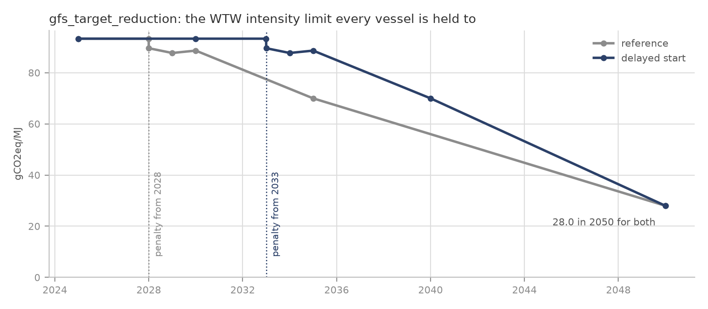

<!--
SPDX-FileCopyrightText: 2026 Fonden Mærsk Mc-Kinney Møller Center for Zero Carbon Shipping
SPDX-License-Identifier: CC-BY-4.0
-->

# Prompt bank

Each entry is a full prompt for one kind of study, tested by handing it to an AI
assistant with no other instructions and checking the deck it built. Pick the
entry closest to your case, change what differs, and give it to your assistant.
The rules every deck shares are in [Building a deck with an AI
assistant](building-a-deck.md); the prompts here only describe their case.

[Session 5](05-build-your-own-case.ipynb) shows new users five examples, with
their prompts: Sessions 1 and 2 rebuilt, one trade between two ports, inland
shipping on the Rhine (its test notes are below) and two fleets in one market.
This bank is the larger set, not displayed on the site: it holds every tested
prompt, so that assistants can start from the closest one and the prompts can
be improved as more people build decks. The start-up prompt of Session 5 reads
the index below.

## Index

One line per prompt, Session 5's included. A new entry adds its line here.

| Entry | The question it answers | Scale | Ships | Policy | What the case changes | Tested |
|---|---|---|---|---|---|---|
| Session 5, example 1: Rebuild Session 1's case | Which fuels do owners choose on one long trade under EU policy? | One long trade: Chile to Rotterdam | 300 Panamax bulk carriers | EU ETS and FuelEU on half the voyage | One run: the fuel choice under policy | 2026-10-19 |
| Session 5, example 2: Rebuild Session 2's reference scenario | What does the world fleet burn to 2050 under a global fuel standard? | The world | The library's whole fleet | EU ETS, FuelEU, global fuel standard | One run: no comparison | 2026-10-19 |
| Session 5, example 3: One trade, two ports | What does the model do on one trade when nothing pushes it? | One trade: Saudi Arabia to China | 200 Suezmax tankers | None | Nothing: the fuel choice on cost alone | 2026-10-26, through the start-up prompt |
| Inland waterways in Germany: what a national CO2 price does (prompt: Session 5, example 4) | Does a national CO2 price move owners to drop-in fuels or new engines? | One river trade in Germany | 300 Rhine cargo vessels | National CO2 price (a copied EU ETS Regulation) | A price: with and without it | 2026-10-16 |
| Session 5, example 5: Two fleets, one market | How much do the owners' efficiency choices matter on the same trade? | One trade of your choice | Two fleets of one class | Your choice | Technology: with and without it | ran first time; criteria not checked |
| EU short-sea feeders: what EU ETS and FuelEU make the owners do | How do owners comply with EU ETS and FuelEU, and at what cost? | One trade, both ports in the EU: Rotterdam to Gothenburg | 1,500 TEU feeders | EU ETS and FuelEU on the whole voyage | A policy: with and without it | 2026-10-19 |
| Green finance: do cheaper loans bring zero-emission ships forward? | Do cheaper loans bring zero-emission ships forward? | One trade: Tubarão to Rotterdam | Panamax ore carriers | EU ETS and FuelEU on half the voyage, in both runs | Finance: cheaper cost of capital for ammonia and methanol ships | 2026-10-19 |
| A global study: the cost of waiting | What does starting a global fuel standard late cost? | The world | The library's whole fleet | Global fuel standard, EU ETS, FuelEU | Timing: the standard on time vs delayed | 2026-10-26 |
| The world fleet, simplified: the global picture at a size you can iterate on | What does a cut-down world fleet do under EU policy? | The world, two or three classes | Library fleets | EU ETS and FuelEU | One run: no comparison | ran first time; criteria not checked |

## What "it works" means here

A deck that runs is not yet a deck that answers the question. An entry is marked
as tested only when a cold build passed all of these:

- **It runs**: exit code 0, no errors, and only the warnings
  `building-a-deck.md` lists as coming with the library.
- **Every number is traceable**: it comes from `assumptions/` by name, or it is
  marked INVENTED where it appears and listed in the `.nav` header.
- **The first year is plausible**: an oil fleet's well-to-wake intensity is close
  to 92 gCO2e/MJ, and the energy consumed matches the size of the fleet.
- **The answer moves the right way**: where the case compares runs, the one with
  the stronger push away from fossil fuels does not burn more of them.
- **The question is one Navigate can answer**: see the limits below.

## What the library does not cover

Cases outside these limits can still be built, but their numbers are INVENTED
and the entry says so up front:

- **Vessels**: only seagoing classes. There is no inland vessel and no
  battery-electric or hydrogen fuel-cell power system.
- **Fuels**: no HVO. Biodiesel (FAME) and e-diesel stand in for drop-in fuels.
- **Policy**: EU ETS, FuelEU Maritime and CII only. National measures are built
  with INVENTED values; a carbon price as a copy of the library's `eu_ets`
  Regulation (building-a-deck.md says why not a `Levy`).
- **Geography**: no distances, port handling costs or bunker transport costs.

## Entries

### Inland waterways in Germany: what a national CO2 price does

**The study.** Dry-cargo motor vessels on the Rhine between Duisburg and
Mannheim, 2026 to 2050, run twice: without policy, and with a CO2 price on the
fossil fuel they burn, standing for Germany's national CO2 price. The price is a
copy of the library's EU ETS regulation moved to the two German ports, so only
its price path is invented. The question
is whether that price moves the owners to drop-in fuels (biodiesel, e-diesel) in
the ships they have, or to new engines.

**What comes from the library.** The engines, tanks and fuel options of the
library's general cargo ships, the fuels and their prices, and the European fuel
production.

**What is INVENTED.** The library has no inland vessel, so the ship is a library
general cargo ship resized for the Rhine: its capacity, power, propulsion curve,
price and lifetime are placeholders. The route, fleet size, bunker logistics and
the CO2 price path are invented too. Replace the placeholders with sourced data
before quoting any result.

**Limits.** Navigate has no river current, locks or low-water periods, and no
battery-electric ship, which is one of the options German inland operators are
actually weighing.

**Tested:** 2026-10-16. The final prompt passed every check above on the first
attempt, built cold and also through Session 5's start-up prompt from a different
inland case (container barges from Duisburg to Frankfurt). Three earlier rounds
found the traps now written in `building-a-deck.md`. Both builds found that at 65
to 150 USD/t the owners pay the price rather than switch fuel, and order a few
more LNG ships; the drop-in fuels need roughly 440 USD/t (biodiesel) to 800-1,100
USD/t (e-diesel). Treat that as a property of the placeholders, not of the Rhine.
2026-10-26, as the model a start-up prompt chose for a different case (Norwegian coastal cargo ships and ferries under Norway's CO2 tax): the chain built and ran cold with no warnings, and found the same: biofuels need roughly 440 USD/t, and the owners pay the tax, order a few more LNG ships and slow down.

**The prompt** is Session 5's example 4, "Inland waterways in Germany", in
`docs/workshop/05-build-your-own-case.ipynb`.

### EU short-sea feeders: what EU ETS and FuelEU make the owners do

**The study.** Container feeder ships between Rotterdam and Gothenburg, 2026 to
2050, run twice: without policy, and under EU ETS and FuelEU Maritime at their
library settings. Both ports are in the EU, so both instruments cover the whole
voyage. The question is how the owners comply (which fuels, which ships) and
what compliance costs them.

**What comes from the library.** The ships (the 1,500 TEU class, with its age
profile, fuel designs, retrofit costs and operating profile), both regulations,
the fuels, their prices and the European fuel production.

**What is INVENTED.** The fleet size, the sea distance, the bunker logistics and
this trade's share of the library's feedstock ceilings.

**Limits.** FuelEU pooling between companies and the ETS's free allowances are
not in Navigate.

**Tested:** 2026-10-19. The final prompt passed every check above on the first
attempt, built cold and also through Session 5's start-up prompt from a different
case (Antwerp to Helsinki). One earlier round showed that a larger feedstock share
lets a small fleet live on Europe's biomass. Both builds found the owners mostly
pay until the mid-2030s, then comply through new methanol and ammonia ships:
well-to-wake emissions over 2026-2050 fall by 34 to 41 %, and e-fuels supply about
half the energy by 2050. Treat that as a property of the placeholders.

````text
You are helping me build a simulation study for Navigate, the shipping
decarbonisation model. Write the files yourself; do not only
describe them.

Before writing anything, find the Navigate repository on my machine (a folder
usually named navigate-zcs; ask me where it is if you cannot find it), then read
docs/workshop/building-a-deck.md in it and follow it. It
says how Navigate works, how to run a deck and read its results, and the rules
every deck follows. This prompt gives the case.

THE DECKS
A new folder, simulations/user/eu_feeder/, holding two decks that differ in one
Include line only:
- no_policy.nav: no regulation at all
- eu_policy.nav: the same, plus includes/eu_policy.inc

THE CASE
Container feeder ships on one route between Rotterdam (the Netherlands) and
Gothenburg (Sweden), 2026 to 2050, yearly steps.
- Fleet: the library's 1,500 TEU container class, with its own split of ship
  designs, age profile and fuel-conversion costs, built with Copy Vessel as
  building-a-deck.md describes. All four designs (oil, LNG, methanol, ammonia)
  can be ordered.
- Fuels: fuel oil and LNG at their library prices; biodiesel (FAME),
  bio-methanol, e-methanol and e-ammonia, all made in Europe.
- Policy: none in no_policy.nav. eu_policy.inc imports the library's EU ETS and
  FuelEU Maritime regulations (Import Regulation "eu_ets" and "fuel_eu"; do not
  copy example_4's own versions) and sets the Jurisdiction of both to the two
  ports. Both ports are in the EU, so both cover the whole voyage. Do not load
  DefaultRegulation: it also brings CII, which is not part of this study.

HOW TO BUILD IT
Build the rest as building-a-deck.md describes for a deck on named ports: a
ROUND_TRIP route between your own ports rotterdam and gothenburg with speeds and
time in port from the class's operational profile, the ports, the bunker
logistics, the European production region, the plants and the producers, with
the shares of the library's feedstock ceilings given below. Leave out the
library's orderbook for this class: it is sized for the world fleet.

NUMBERS
Everything not listed here comes from the library, by name. These are
placeholders, INVENTED for this case: mark each one where it appears, list them
all in both .nav headers, and keep them in includes/placeholders.inc (the plain
numbers in their own files, listed there as comments).
- Fleet: 80 ships in 2026, a segment owned by many companies
- Route: 520 nm each way
- Bunker logistics: 300 nm from the European plants to each port, 0.03 USD per
  ton per nm
- Feedstock: this trade's share of the library's shipping share, 0.001 of the
  used cooking oil, the biomass and the biogenic CO2 (about this fleet's share of
  world shipping's energy, as building-a-deck.md explains)

BEFORE YOU TELL ME IT WORKS
Run both decks one after the other and report on each as building-a-deck.md
says. Then, from the two reports, give me side by side:
- the share of energy by fuel in 2026, 2030, 2040 and 2050;
- the fleet's well-to-wake emissions in 2026 and 2050, and summed over 2026-2050;
- the ships of each design in 2050, and the fuel conversions over the period;
- what EU ETS and FuelEU cost the owners each (RegulationExpenses per
  regulation), in 2030 and 2050.
Say plainly how the owners comply: by switching fuel in the ships they have, by
new or converted ships, or mostly by paying. Remind me which inputs are
placeholders.
````

### Green finance: do cheaper loans bring zero-emission ships forward?

**The study.** Panamax bulk carriers carrying iron ore from Tubarão (Brazil) to
Rotterdam, 2026 to 2050, under EU ETS and FuelEU Maritime as the library sets
them. The voyage leaves the EU, so both cover half of it. Two runs: the library's
cost of capital, and a green-finance case where ammonia and methanol ships borrow
two percentage points cheaper. The question is whether cheaper finance alone
changes when, and how many, such ships are ordered.

**What comes from the library.** The ships (the 80,000 DWT class, with its age
profile, designs, retrofit costs and operating profile), both regulations, the
fuels and their prices, the cost of capital, and the fuel production in the
Americas.

**What is INVENTED.** The size of the green-finance discount, the fleet size,
the sea distance, the bunker logistics and this trade's share of the feedstock
ceilings.

**Limits.** Navigate prices finance through the cost of capital only: no
guarantees, grants or loan terms.

**Tested:** 2026-10-19. The final prompt passed every check above on the first
attempt, built cold and also through Session 5's start-up prompt from a different
case (US Gulf grain to Rotterdam, 1.5 points). Both builds found that cheaper
loans add a few ammonia and methanol ships (about 6 to 10 by 2050) but bring
nothing forward, and cut emissions by 1 to 2 %: the gap is the fuel's cost, not
the ship's finance. Treat that as a property of the placeholders.
2026-10-26, as the model a start-up prompt chose for a different case (Tubarão to Qingdao, no regulation): the chain built and ran cold with no warnings. Cheaper finance brought about 7 more ammonia and 7 more methanol ships by 2050, all burning pilot oil: without a policy, finance alone moves the orders, not the fuel.

````text
You are helping me build a simulation study for Navigate, the shipping
decarbonisation model. Write the files yourself; do not only
describe them.

Before writing anything, find the Navigate repository on my machine (a folder
usually named navigate-zcs; ask me where it is if you cannot find it), then read
docs/workshop/building-a-deck.md in it and follow it. It
says how Navigate works, how to run a deck and read its results, and the rules
every deck follows. This prompt gives the case.

THE DECKS
A new folder, simulations/user/green_finance/, holding two decks that differ in
one Include line only:
- reference.nav: the library's cost of capital for every ship
- green_finance.nav: the same, plus includes/green_finance.inc

THE CASE
Panamax bulk carriers (~80,000 DWT) carrying iron ore from Tubarão (Brazil) to
Rotterdam, laden out and back in ballast, 2026 to 2050, yearly steps.
- Fleet: the library's 80,000 DWT bulk carrier class, with its own split of ship
  designs, age profile and fuel-conversion costs, built with Copy Vessel as
  building-a-deck.md describes. All four designs (oil, LNG, methanol, ammonia)
  can be ordered.
- Fuels: fuel oil and LNG at their library prices; e-ammonia and e-methanol
  made in the Americas (the library's "americas" region).
- Policy, in both decks: the library's EU ETS and FuelEU Maritime (Import
  Regulation "eu_ets" and "fuel_eu"; do not copy example_4's own versions), with
  the Jurisdiction of both set to rotterdam only. The voyage leaves the EU, so
  each covers half of it. Do not load DefaultRegulation: it also brings CII,
  which is not part of this study.
- Green finance: green_finance.inc sets the CostOfCapital of the ammonia and
  methanol ships to their library value minus the discount below, as an
  expression of the library's Forecast or Variable and a placeholder Variable.
  Nothing else differs between the decks. Set the Fleet's
  TechnologyCostOfCapital = Variable("cost_of_capital_vessel") in both decks:
  without it, efficiency technology is financed at each ship's own rate, and the
  discount would reach it too.

HOW TO BUILD IT
Build the rest as building-a-deck.md describes for a deck on named ports: a
ROUND_TRIP route between your own ports tubarao and rotterdam with speeds and
time in port from the class's operational profile, the ports, the bunker
logistics, the americas production region, the plants and the producers, with
the shares of the library's feedstock ceilings given below. Leave out the
library's orderbook for this class: it is sized for the world fleet.

NUMBERS
Everything not listed here comes from the library, by name. These are
placeholders, INVENTED for this case: mark each one where it appears, list them
all in both .nav headers, and keep them in includes/placeholders.inc (the plain
numbers in their own files, listed there as comments).
- Green-finance discount: 0.02 (two percentage points) off the cost of capital
  of ammonia and methanol ships
- Fleet: 150 ships in 2026, a segment owned by many companies
- Route: 5,000 nm each way
- Bunker logistics: 500 nm from the plants to tubarao and 5,000 nm to rotterdam,
  0.02 USD per ton per nm
- Feedstock: this trade's share of the library's shipping share of biogenic CO2,
  0.002 (about this fleet's share of world shipping's energy, as
  building-a-deck.md explains)

BEFORE YOU TELL ME IT WORKS
Run both decks one after the other and report on each as building-a-deck.md
says. Then, from the two reports, give me side by side:
- the newbuilds of each design per year, and the ships of each design in 2035
  and 2050;
- the share of energy by fuel in 2026, 2035 and 2050;
- the fleet's well-to-wake emissions summed over 2026-2050;
- the investment freight rate of each design in 2030 and 2045.
Say plainly what the cheaper finance changed: earlier or more zero-emission
ships, a different fuel burnt, or nothing; and whether those ships actually
burn the fuel they were built for. Remind me which inputs are placeholders.
````

### A global study: the cost of waiting

**The study.** The mid-regulation reference scenario includes a global fuel standard (`gfs`): a well-to-wake intensity limit that every ship is held to worldwide, tightening from 2028 to 2050. What if it started five years late, but kept the same 2050 target? No deck to build from scratch here: the scenario is run twice, as it is and with every date before 2050 moved later, on the coarse time grid of [Session 2](https://colab.research.google.com/github/zerocarbonshipping/navigate-zcs/blob/workshop-colab/docs/workshop/02-run-a-global-case.ipynb) so each run takes a few minutes. The answer is one number worth remembering: the extra megatonnes of CO2e a delay costs, and whether the delayed run catches up by 2050. The change goes in a copy of the regulation file, so the reference scenario itself stays untouched.

**How it differs from the scenarios in the repository.** The four reference scenarios in `simulations/scenarios/` differ in *how strict* the regulation is: none at all, EU ETS and FuelEU only (business as usual), or those plus a global fuel standard that is moderate (mid) or strict (strong). Both standards start in 2028. This case keeps the mid scenario exactly as it is and changes only *when* its standard starts, which none of them explores. It also runs on the coarse grid, so compare its two runs with each other, not with the yearly results of Session 2.



*The global fuel standard of the mid-regulation scenario (grey) and the same standard started five years later, with the same 2050 target (blue).*

**What comes from the library.** Everything: the decks are the Center's
mid-regulation reference scenario on the coarse grid of
`simulations/scenarios/workshop_whatif/`, one of them run as it is.

**What is INVENTED.** Nothing but the delay itself.

**Limits.** The coarse grid: compare the two runs with each other, not with
the yearly reference scenarios of Session 2.

**Tested:** 2026-10-06, as what was then Session 5's fourth example: built cold, it ran
without errors on the first attempt. 2026-10-26, built cold again with a five-year
delay and checked against the criteria above: both decks ran with only the
library's expected warnings, and the delay added about 1,560 Mt CO2e over
2026-2050 (+6 %), still 20 Mt a year more in 2050. The two decks share one
`plots/` folder, so compare them from their reports.

````text
You are helping me run a global study with Navigate, the shipping
decarbonisation model. Write the files yourself; do not only
describe them.

Before writing anything, find the Navigate repository on my machine (a folder
usually named navigate-zcs; ask me where it is if you cannot find it), then read
docs/workshop/building-a-deck.md in it and follow it. It
says how Navigate works, how to run a deck and read its results, and the rules
every deck follows. This prompt gives the case.

ABOUT THESE DECKS
- simulations/scenarios/ holds the Center's reference scenarios. The ones in
  simulations/scenarios/workshop_whatif/ are the no-, mid- and strong-regulation
  scenarios on a coarse time grid (2026, 2027, 2030, then every four years to
  2050), so that one run takes a few minutes instead of about twenty-five. This study uses the
  mid-regulation one.
- The reference decks load DefaultReport already, so every run writes the
  report. Its "Global" sheet has one row per time step.

THE STUDY
The mid-regulation reference scenario includes a global fuel standard ("gfs"):
a limit on the well-to-wake greenhouse-gas intensity of the energy every ship
uses, applied worldwide and tightening year on year. A ship above the limit pays
a penalty; a ship below it earns surplus units it can sell. It is defined in
simulations/scenarios/0_includes/mid_regulation.inc: the Regulation "gfs", the
limit as Forecast "gfs_target_reduction" (a fraction of 93.3 gCO2eq/MJ) and the
penalty as Forecast "gfs_remedial_unit" (USD per t CO2eq above the limit, from
2028).

I want to know what it costs to start the standard late but keep its 2050
target: [THE DELAY, e.g. "five years"].
In my own copy of that file, move every date of both Forecasts that falls
before 2050 by that many years (so the penalty starts in 2033 instead of 2028
for a five-year delay), and leave the 2050 rows where they are. Mark each moved
row with a comment giving its reference date. Nothing else changes.

THE DECKS
Work in a new folder, simulations/user/my_global_study/. Do not change the
reference scenario or its includes.
- reference.nav: a copy of
  simulations/scenarios/workshop_whatif/workshop_basecase_mid_regulation.nav,
  with its two Include paths rewritten so they still point at the original
  files from the new folder.
- delayed.nav: the same, except that it includes your own copy of
  mid_regulation.inc (as includes/gfs_delayed.inc in the new folder) with the
  dates moved as above.
Both decks must differ in that one include line only.

BEFORE YOU TELL ME IT WORKS
Run both decks (a few minutes each; run them one after the other, or in the
background, and wait for both), and report on each as building-a-deck.md says.
Then, from each report, give me side by side:
- the fleet's well-to-wake emissions at every time step (Mt CO2e per year);
- the emissions summed over 2026-2050, weighting each step by the years it
  stands for (say how you weighted them), and the difference: the extra Mt CO2e
  the delay costs;
- the share of the energy consumed in 2030, 2038 and 2050 by each fuel, and
  whether the delayed run catches up with the reference by 2050.
Say plainly that these are coarse-grid runs: compare them with each other, not
with the yearly reference scenarios.
````

### The world fleet, simplified: the global picture at a size you can iterate on

**The study.** No geography here: the Center's reference scenarios model twenty-three vessel classes on the library's own global operating profiles, and the only "places" are two abstract ports that exist so the EU measures know what they cover. This prompt keeps two or three classes of your choice, imported whole from the library with their own fleets, orderbooks and technologies, against the library's full fuel-supply chain in five regions and under EU ETS and FuelEU. Expect several minutes per run.

**What comes from the library.** Everything: the deck is almost entirely `Load`
statements, and each class is imported whole, with its own vessels, age
distribution, orderbook, technologies and retrofit costs.

**What is INVENTED.** Nothing. Which two or three classes to keep is the user's
choice.

**Limits.** Fewer fleets than the library's twenty-three (building-a-deck.md says
what that means for DefaultConverterAvailable), and EU ETS and FuelEU only: no
global fuel standard.

**Tested:** as Session 5's fourth example (added 2026-09-25): built cold, it ran
without errors on the first attempt. It has not yet been checked against the
criteria above the way the other entries were. Moved here from Session 5 on
2026-10-26.

````text
You are helping me build a simulation deck for Navigate, the shipping
decarbonisation model. Write the files yourself; do not only
describe them.

Before writing anything, find the Navigate repository on my machine (a folder
usually named navigate-zcs; ask me where it is if you cannot find it), then read
docs/workshop/building-a-deck.md in it and follow it. It
says how Navigate works, how to run a deck and read its results, and the rules
every deck follows. This prompt gives the case.

THE DECK
A new folder, simulations/user/[YOUR FOLDER NAME]/.

THE CASE
A cut-down version of the Center's reference scenarios. No route, no map, no real
ports - I want the global picture, not a trade.
simulations/scenarios/basecase_mid_regulation/ is the full reference scenario
this case cuts down.

- Fleets: [TWO OR THREE CLASSES, e.g. tanker_127k_dwt and bulk_carrier_80k_dwt],
  imported whole from the library (Import Fleet "..."), so each brings its own
  vessels, age distribution, orderbook, technologies and retrofit costs
- Geography: none of your own. Load DefaultVoyage for the per-class operating
  profiles and DefaultPort for the two abstract ports the library uses.
- Fuels and production: load the library's whole chain - DefaultEmission,
  DefaultFeedstock, DefaultFuel, DefaultProducer, DefaultPlant, DefaultRegion,
  DefaultSource, DefaultTransport
- Regulation: EU ETS and FuelEU at their library settings (DefaultRegulation)
- Also load what every library deck needs, as building-a-deck.md lists it.

NUMBERS
Everything comes from the library by construction here, because the deck is
almost entirely Load statements. If you find yourself writing a number, stop and
tell me why the library has none.

DECK RULES
This deck has fewer than the library's twenty-three fleets: follow what
building-a-deck.md says about DefaultConverterAvailable.

BEFORE YOU TELL ME IT WORKS
Expect a run of five to ten minutes, not seconds. Tell me the fuel mix at both
ends of the horizon, from the report.
````
